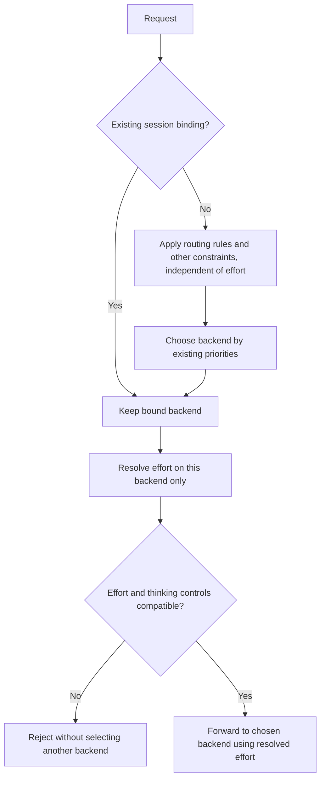

# Capability projection and reasoning effort routing

[Agent boundaries](spec.md#agent-boundaries) owns native configuration behavior.
[Request parameters](../model-routing/spec.md#request-parameters) owns effort
preservation, model maps, and fixed candidate effort. The
[configuration schema](../configuration/spec.md#model-effort-maps) owns persisted
maps and target validation; the [model CLI](../cli/models/spec.md#model-effort-maps)
owns their management syntax. Shared terms are in [CONTEXT.md](../../CONTEXT.md).

## Design decision

Changing only reasoning effort must not change the backend chosen by routing.
For the same routing snapshot, continuity context, and other request constraints,
the gateway selects the same provider/model or rejects the request. It must not
exclude that backend because of effort and choose another one instead.

The advertised effort set is the intersection of candidate input sets after
explicit user mappings. A union describes partial coverage only; it is not the
native selector contract. Mappings can expand the intersection without making
effort an implicit model selector.

## Domain ownership

| Concept | Owner and meaning | Excluded meaning |
| --- | --- | --- |
| Upstream effort declaration | Concrete Model; accepted catalog plus local metadata overrides | Caller preference, authorization proof, or default |
| Reasoning effort mapping | Concrete Model, scoped by native protocol; explicit caller-name to upstream-value correspondence | Metadata override, fixed effort, thinking toggle, or inferred quality equivalence |
| Alias effort coverage | Derived from explicit candidate references, model mappings, and candidate-local settings | New Model, independently editable capability resource, or current winner snapshot |
| Fixed candidate effort | Alias candidate configuration; unconditional upstream effort selected by the user | Conditional mapping or global model default |
| Native capability projection | Agent integration; represents gateway-facing input names in its native selector | Model-specific upstream mapping performed before the gateway selects a destination |
| Actual request and native preference | Caller and native Agent | A value selected by capability metadata |
| Eligibility, ranking, and session binding | Gateway admission and continuity | Authority to discard an explicit effort or move an existing conversation |

Provider and AgentTarget remain the principal independently managed objects.
Model remains provider-owned. ModelAlias references existing Models and does not
create an account pool. Mapping needs no independent identity or lifecycle.

## OMP precedent

OMP separates selectable names (`thinking.efforts`) from wire values
(`thinking.effortMap`). Its OpenAI paths can override that map through
`compat.reasoningEffortMap`; the inspected mapper resolves compat override,
then model map, then identity. This supports separating declaration from explicit
translation. It does not establish how a multi-destination gateway must combine
candidate capabilities.

Pinned source:
[configuration schema](https://github.com/can1357/oh-my-pi/blob/7414b7c919b59dd14db354a8f6b9164426237dff/packages/coding-agent/src/config/models-config-schema-bundle.ts#L121-L168),
[OpenAI effort mapper](https://github.com/can1357/oh-my-pi/blob/7414b7c919b59dd14db354a8f6b9164426237dff/packages/ai/src/providers/openai-shared.ts#L926-L939),
[request effort acceptance](https://github.com/can1357/oh-my-pi/blob/7414b7c919b59dd14db354a8f6b9164426237dff/packages/ai/src/stream.ts#L1696-L1725).

## Resolution and coverage

For each concrete candidate and protocol, resolve one supplied input effort in
this order. The authoritative syntax is linked above; this is resolution pseudocode.

```text
resolve(candidate, input effort)
  if this alias candidate has an explicit fixed upstream effort
    validate and use that fixed value without applying a model map
  otherwise
    use the explicit model mapping for the input name, if present
    otherwise use the input name unchanged
  require mapped/fixed targets to be explicitly declared upstream efforts
  for identity requests, reject known mismatches without inventing unknown metadata
  reject incompatible thinking switches without modifying them
```

| Derived set | Meaning |
| --- | --- |
| Candidate input set | Valid declared identity inputs plus explicit map keys whose targets are declared upstream efforts. An explicit mapping overrides identity for that key. |
| Fixed candidate input set | Advertise only its fixed upstream name, not every possible input. Fixed override behavior on other incoming values remains explicit intent, not evidence those inputs are supported. |
| Alias advertised set | Intersection of all configured candidate input sets; every advertised input can be resolved on any candidate without using effort to choose one |
| Partial-coverage set | Union of candidate input sets; useful for explanation, not published as universally selectable alias effort |
| Routing-eligible subset | Candidates satisfying protocol, authorization, availability, other request constraints, and continuity; effort does not remove or rerank candidates |

Configured membership includes temporarily unavailable and disabled candidates;
those facts do not rewrite persistent selectors. Advertised support is a
configuration declaration, not a promise of present capacity. Unknown effort
metadata contributes no advertised inputs. A reasoning-support boolean or a
toggle-only declaration does not create effort names. Mapping targets require
explicit effort declarations and must survive metadata adoption validation.

Maps are single-step, many-to-one functions. Targets are upstream values, not
keys to resolve recursively. There is no implicit clamping, sorting by model
quality, nearest-level fallback, or automatic map inferred from a model name.
An omitted request effort stays omitted unless fixed candidate effort applies.
Thinking switches and budgets are not effort values and are not map targets.

## Request processing



Selection precedes effort resolution and validation. Effort must not affect
candidate eligibility, scores, tie-breaking, or binding identity. Other routing
inputs can still change a backend independently; this rule does not promise a
fixed backend across stateless requests or changing availability.

Validate before upstream dispatch and before publishing a new session binding.
An effort rejection must not create a binding, attempt another backend, silently
downgrade the effort, or remove the caller's thinking switch. Existing bindings
remain unchanged. A caller can explicitly change the model, alias, mapping, or
effort after an actionable incompatibility result.

Request diagnostics distinguish caller-facing input, resolved upstream value,
selected model, and source (`fixed`, `map`, `identity`, or `omitted`) under the
[minimal request record](../diagnostics/spec.md#minimal-request-record).
These are bounded decision facts, not permission to store full prompts or credentials.

## Examples

Here A declares low/high and B declares high/max. A has higher routing priority.
These are domain examples, not persisted syntax.

| Candidate maps | Caller input | Routing result before effort validation | Effort outcome |
| --- | --- | --- | --- |
| None | low | A | Send low to A; not a shared selector choice because B lacks low |
| None | high | A | Send high to A; shared selector choice |
| None | max | A | Reject; do not select B even though B supports max |
| A maps max to high | max | A | Send high to A; max is now a shared selector choice |
| A maps low to high | low | A | Send high to A; still not shared unless B accepts low too |
| A maps max to high | medium | A | Reject; do not infer a mapping |
| None; conversation already bound to B | low | B | Reject without moving to A |

Without mappings, the advertised set is high; low/high/max is only the union of
partial endpoint coverage. With A mapping max to high, advertised choices become
high/max. A backend change caused independently by availability or priority can
then preserve either input. Translation expresses the user's preference, not
equal reasoning quality.

## Adapter and mutation boundaries

A gateway native entry must expose gateway-facing effort names and send those
names to the gateway. Endpoint-specific maps run inside the gateway after it
knows the candidate. Copying one endpoint's map into the alias's native entry
would lose caller intent before routing and can double-map a value.

Model effort maps are gateway-only. Direct native entries retain the actual
upstream capability declarations; tmax does not install these maps into an
Agent's mapping carrier, even if that Agent can represent one. OMP's native
carriers do not qualify gateway maps on direct routes or a Messages provider's
wire effort encoding. Do not introduce cross-protocol translation,
thinking-budget conversion, or unsupported Messages effort writes.

Existing DSH empty-selector suppression remains a native representation limit:
`reasoningEfforts: false` marks the native alias non-reasoning. It does not prove
that all upstream candidates lack reasoning. Explicit maps can close gaps in
shared input coverage; do not fabricate maps to avoid an empty intersection.
Missing declarations or unrepresentable native names still require explicit
handling under the native contract, without resetting user preferences.

Mapping edits, membership edits, metadata adoption, or fixed-effort edits can
change both advertised names and coverage. Explicit native reapplication remains
separate from configuration activation. Priority-only changes do not change
these declaration sets. Retained requests use one coherent admission snapshot;
configuration edits do not replay completed inference or reassign bindings.

## Consistent ownership

Routing, configuration validation and management, native projection, catalog
adoption, diagnostics, and consumer guidance share this resolution contract.
Intersection derivation uses mapped input coverage, not raw upstream names.
Changing only effort selects the same backend or rejects without a replacement,
for both new requests and bindings. Preview and executed validation use the same
effective-target rules.

No automatic map migration is performed: absent maps preserve identity behavior;
existing fixed candidate effort remains a distinct explicit override. Do not
reinterpret a fixed value as a total map, guess desired translations, or keep
competing projection paths. This contract does not change user configuration.
