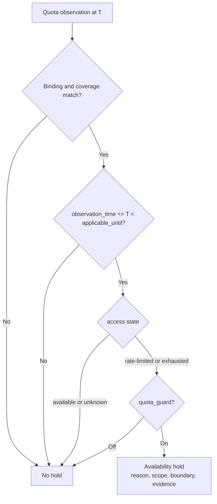

# Routing availability boundaries

This document explains the boundaries behind [model selection](spec.md#selection-and-continuity)
and [request fallback](spec.md#request-fallback-and-failure-priority-override).
Shared terms are in [CONTEXT.md](../../CONTEXT.md). The
[configuration contract](../configuration/spec.md#provider-instances) owns
`quota_guard` syntax and defaults; the [routing contract](spec.md) owns observable
behavior.

## Decisions

| Pressure | Considered alternative | Decision and reason |
| --- | --- | --- |
| Evidence changes while requests run | Store a mutable suspended flag per provider | Derive candidate eligibility from time-bounded quota observations; the observation, not a copied flag, is the evidence |
| Quota exhaustion and preference answer different questions | Lower priority when a window is full | An availability hold removes a candidate from selection; effective priority is unchanged |
| A provider may allow paid continuation | Treat every full window as upstream denial | `quota_guard` is an explicit user policy, off by default; exhausted included allowance is not proof of blocked access |
| A window may cover one model or all models | Always exclude the whole provider | The observation's declared coverage determines the hold's scope; no implicit expansion |
| A reset may happen early or not at all | Disable until manual reset | Source applicability, the guard's observation age, and the announced reset bound the hold; a newer observation wins; no reset creates no automatic quota hold |
| A transient 429 may be quota exhaustion, rate limiting, or capacity | Treat every 429 as exhaustion | Only source-qualified quota evidence creates a quota hold; other failures remain request failures |
| Confirmed quota denial must survive restart and allow manual intervention | Expire a copied flag on a timer, or set user `enabled=false` | Retain authorization-bound quota suspension separately; only confirmed recovery or explicit manual resume clears it |
| A retained session may become ineligible | Silently select another provider | Block the retained destination with an actionable error; move only at a qualified new-session boundary |
| A client may switch models on error | Rely on client fallback | Attempt fallback inside tmax only where the alias permits it, before response bytes |

## Quota evidence

One quota observation describes one provider, one quota window, and its exact
model coverage:

| Field | Meaning |
| --- | --- |
| Provider binding | Provider incarnation and authorization generation the observation belongs to |
| Window | Stable provider-defined window identity, such as `rolling`, `weekly`, or `monthly` |
| Coverage | Provider-wide or the exact upstream models the window applies to |
| Observation time | When the source condition was observed |
| Applicability bound | The last instant at which the source contract permits this observation to be used |
| Access state | `available`, `rate-limited`, `exhausted`, `unavailable`, or `unknown` |
| Reset announcement | The announced window boundary, when one exists |
| Source | The qualified observation source |

Several providers may observe the same upstream allowance. That does not make
their observations interchangeable or establish that one provider's hold applies
to another.

## Suspension authority

The [automatic suspension contract](spec.md#automatic-quota-suspension) differs
from a time-bounded included-allowance hold. The provider observation authority
owns suspension and its publication epoch alongside quota evidence. A scoped
denial is a state transition, not a rewritten quota percentage or configuration.

| Boundary | Invariant |
| --- | --- |
| Identity | Provider incarnation, authorization generation, integration, endpoint, and quota-source contract bind the state; a renamed label does not identify another account |
| Publication | Capture the resume epoch before external I/O; manual resume fences older denials and checks, and a check begun before a newer denial cannot clear it |
| Persistence | Successful saves survive restart; failed saves retain a coalesced binding-scoped pending denial in the daemon, with unconfirmed durability until local publication succeeds |
| Recovery scheduling | Check only suspended enabled providers, through the supported quota source; reserve the next due boundary before I/O so failed checks cannot create a tight loop |
| Manual resume | Supersede the existing suspension and old retained guard fact without changing user enablement; fresh evidence may suspend again |
| Admission | Capture suspension with observation evidence; an in-flight attempt retains its original authority and cannot borrow a later account binding |
| Independent writers | A distinct manual-resume revision supersedes pending denial state; a disk recovery epoch alone cannot erase a denial the checking process never observed |

The pending record contains only its full binding, safe denial evidence, fences,
and publication error. It is not a second quota history or a copied configuration.
Reads merge the effective pending delta without writing. Successful publication
acknowledges only the matching denial revision; a newer receipt cannot be lost.
Disk-only and daemon-effective diagnostic projections remain separate.

## Hold derivation

At selection instant `T`:

```text
hold(candidate) =
    quota_guard applies to provider
    and observation binding matches candidate
    and coverage includes candidate model
    and access_state in {rate-limited, exhausted}
    and observation_time <= T < source_applicability_bound
    and T < observation_time + quota_guard.max_observation_age_seconds
    and reset_announcement exists and T < reset_announcement
```

`unavailable` is an access condition in its own right, not a quota-guard
condition. Unknown or unavailable quota evidence does not create a quota hold.

### Guard policy

`quota_guard` is an optional provider-scoped policy table. Its presence enables
the guard; its absence disables it.

| Field | Meaning |
| --- | --- |
| `max_observation_age_seconds` | Positive integer; the observation must be no older than this at selection. It bounds how long a user policy may treat a provider report as current. It is not a provider freshness claim. Default `3600`. |

The observation-age bound is what makes a consumed-only source usable for
routing without pretending it has a provider-supplied validity interval. The
provider's display freshness remains whatever its own contract says; the guard's
age bound is a separate, explicit policy.

| Access state | Guard off | Guard on |
| --- | --- | --- |
| `available` | Eligible | Eligible |
| `rate-limited` | Eligible | Held until the boundary |
| `exhausted` | Eligible | Held until the boundary |
| `unavailable` | Existing access rules | Existing access rules |
| `unknown` | Eligible | Eligible |



## Laws

1. A hold is derived from current evidence. It is not a durable configuration
   edit or a separately maintained suspension state.
2. A hold changes candidate eligibility only. It never changes effective
   priority, model enablement, or provider enablement.
3. A hold affects new selection and the eligibility of an existing destination,
   but it never reassigns that destination. An ineligible retained destination
   is reported with its evidence and recovery boundary rather than silently
   reassigned.
4. A hold ends at the earlier of its source applicability bound, the guard's
   observation-age bound, and its announced reset. At that instant the old
   observation is no longer usable as policy evidence; the next request verifies
   the outcome.
5. A quota observation without an announced reset creates no automatic quota
   hold. A user may declare a separate manual reset input, but it is not evidence
   of a provider reset.
6. The guard's observation-age bound is a policy limit, not a claim that the
   provider supplied a validity interval or that the observation remains true
   until then.
7. A generic rate-limit, capacity, transport, or unknown upstream failure is not
   quota evidence and creates no quota hold.
8. A newer observation replaces an older one. A failed refresh does not extend an
   older observation's applicability; an older observation cannot overwrite a
   newer one.
9. Coverage is exact. A provider-wide window covers all of that provider's models;
   a model-covered window covers only those models; no observation expands to
   another provider.

## Selection and attempts

Selection first builds the eligible candidate set for the admission snapshot and
instant. Effective priority orders that set. The highest-priority eligible
candidate is selected; ties use the stable model identity rule.

An attempt plan is separate from eligibility and preference:

- A stateless alias may attempt its ordered eligible candidates under an explicit
  fallback policy, each provider at most once, only before any response bytes are
  delivered.
- A session-stable alias has one retained destination and does not migrate it.

A quota hold does not authorize replay, waiting, or a same-provider retry loop.
When every candidate is held by quota, selection returns an actionable
unavailable result with the earliest recovery boundary; it does not select a
held candidate or guess that a reset occurred.

## Acceptance boundary

| Case | Required result |
| --- | --- |
| Guard absent, access `exhausted` | Candidate remains eligible |
| Guard present, access `rate-limited` or `exhausted`, observation within age, reset future | Candidate held; effective priority unchanged |
| Observation older than `max_observation_age_seconds` | No hold |
| Reset or source applicability bound passed | No hold; next request verifies |
| Access `available` or `unknown` | No hold |
| No announced reset | No automatic quota hold |
| Generic 429, capacity, transport, or unknown failure | No quota hold |
| Authorization generation changed | Prior observation and its hold do not apply |
| New observation says `available` | Hold clears at the next admission |
| Every candidate held | Actionable unavailable result with earliest recovery boundary; no dispatch |
| Retained destination held | Reported unavailable with evidence; not silently reassigned |

## Consequences

- `quota_guard` is provider-scoped, off by default, and does not create a global
  policy or a second priority hierarchy.
- A provider's quota observation may affect display without affecting routing.
  Only an applicable, blocking access state under an enabled guard creates a hold.
- Request history and selection explanation must show the hold reason, window,
  coverage, observation time, applicability/reset boundary, and the policy that
  authorized it, without exposing secrets.
- OpenCode Go's qualified blocking state and inference denial follow automatic
  quota suspension. Consumed percentages alone remain display-only. The optional
  `quota_guard` remains a distinct user policy for included allowance.
