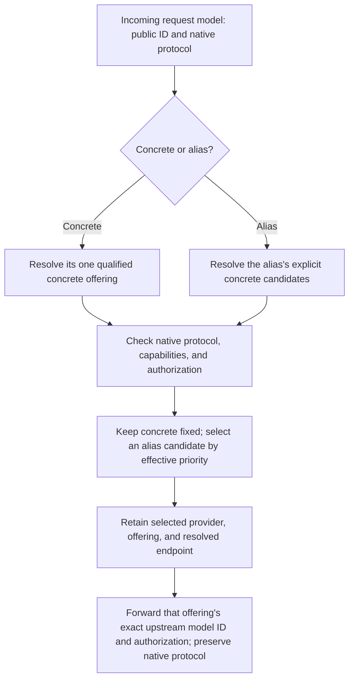

# Model selection and priority rules

This specification owns model-catalog integration, concrete model references,
model aliases, priority-rule evaluation, and selection continuity.
[Input values and acquisition](inputs/spec.md#input-values-and-acquisition) owns
the facts used by quota and reset rules. [Product](../product/spec.md) owns
provider instances, Agent provider configuration, the model gateway, and security. Shared terms are in
[CONTEXT.md](../../CONTEXT.md).
This is the routing acceptance contract; runtime evidence remains scoped to the
specific snapshot, native client, operation, and provider authorization exercised.

The [configuration contract](../configuration/spec.md) owns private persistence of
these rules and supplies a [complete example](../configuration/example.toml).
Callers manage providers, models, priorities, schedules, named quota/reset
rules, explicit alias candidates, and target selections through explicit CLI
arguments; they need not author TOML, JSON, or YAML documents. Management changes follow the
[CLI dry-run and execution contract](../cli/spec.md#dry-run-and-execution):
optional `--dry-run` assesses current effects without mutation, reservation,
secret reads, login, or upstream calls. Actual execution checks current inputs
and rejects conflicting changes during the operation before overwrite. Each
separate call recomputes from current state; no prior preview is required.

## Model catalog

tmax must use [models.dev/api.json](https://models.dev/api.json) as its shared
default metadata directory. During setup, the user selects a catalog provider as
the baseline for a local provider's service and model metadata, then overrides
only the supported fields that differ. Several instances may select the same
entry. The selection is independent of the local provider ID: renaming deepseek-2
to work must not change its deepseek metadata source. Custom services absent from
the directory remain configurable through explicit local definitions.

The JSON's top-level provider keys and provider `id` identify catalog entries,
not configured accounts. Each entry's `models` map supplies provider-local model
IDs and metadata. The exact upstream model ID, not its display `name` or optional
`canonical_model_id`, forms the suffix in a qualified local model name. Canonical
identity may relate models for display; it must not merge offerings or choose an
upstream model ID across providers.

The selected entry supplies defaults using the following source fields where present:

| Source metadata | Use in tmax |
| --- | --- |
| Provider `name`, `doc` | Display name and documentation link, with explicit local overrides |
| Provider `api` | Source-labeled endpoint guidance only; never an inferred protocol base, region selector, or inherited endpoint setting |
| Provider `env` | Suggested credential-reference names; never credentials or automatic environment access |
| Provider `npm` | Integration-selection evidence, not an instruction to install or execute a package |
| Model `name`, `description`, `family`, release fields | Model description and grouping metadata |
| Model `limit`, `modalities`, `tool_call`, `reasoning`, `reasoning_options`, `temperature` | Declared limits and capability metadata, mapped only where the integration supports them |
| Model `cost` | Reference pricing, retaining source and known units rather than inventing a bill or tariff schedule |

Effective metadata has two layers: explicit instance-local overrides take precedence
over the selected catalog baseline; an absent field in both remains unknown. The
user may override supported provider fields and individual-model metadata. Save the
catalog reference and explicit differences, not a complete copy of inherited values.
Overrides must not mutate the shared catalog or another instance using it.

Merge object fields recursively by key; replace arrays as complete values rather
than concatenating them. For example, overriding `limit.output` preserves inherited
`limit.context`, while overriding `modalities.input` replaces that list and preserves
`modalities.output`. Valid explicit `false`, `0`, and empty arrays must not be treated
as absent. Validate each field's type and constraints. Removing an override restores
inheritance; an explicit value equal to the current default still remains an override.
Do not infer reset behavior from a false-like value.

The user must see catalog values, overrides, effective values, and provenance in
CLI and Web. Provider/model identity fields are not ordinary metadata overrides:
changing a source entry, local provider ID, or upstream model ID must use the
corresponding explicit configuration operation and show affected references.
The catalog reference and canonical model identity must never replace local IDs.

Provider integration, region/endpoints, authentication, optional subscription
data, enabled-model selection, priorities, schedules, input declarations,
and priority rules are local settings, not fields inherited from models.dev.
Endpoint consumers use the
[integration resolver](../integrations/spec.md#endpoint-resolution), not metadata
override merging. Two instances sharing an `env` suggestion must still choose
their own credential or secret reference; the suggestion must not silently
select one shared key.

Upstream discovery and official documentation may validate metadata or suggest a
change. Applying that change must be explicit local configuration, not an invisible
third precedence layer. Additional upstream models may be registered explicitly;
an inference request must not register an unknown model implicitly. Catalog
models do not become enabled or published merely because they are listed.

A catalog entry or capability override is not proof of credential validity,
entitlement, native protocol compatibility, or tmax integration support. Missing
fields remain unknown. Overrides declare configuration intent, not verified
support. Subscription quotas, renewal details, and time-dependent tariffs require
their own provider evidence or explicit user input.

The catalog is shared reference data, not another user-managed provider resource.
Fetch it without upstream credentials and show its source and retrieval time.
Use the last successfully validated snapshot when a refresh fails, marking it
stale; without a snapshot, expose unavailability and permit explicit configuration.
Catalog retrieval must not be on the inference request path. A missing directory
entry must not silently delete an already configured provider or model; retain
the local configuration and show that the catalog reference is missing.
Catalog traffic follows the
[outbound network policy](../product/spec.md#outbound-network-policy) and
[transport deadlines](../product/spec.md#transport-deadlines).

Downloading directory updates and applying changed defaults are distinct actions.
Effective metadata uses an accepted snapshot, not a live network response.
Applying changed model capabilities or limits must report effects on providers,
routes, and agent settings; optional `--dry-run` exposes those effects without
applying them. A changed catalog `api` value remains endpoint guidance.
Accepting that guidance requires an explicit provider endpoint/region change
under the integration resolver, with impact reporting for credential
destinations, routes, retained sessions, and native agent settings. It is not an
inherited catalog-default update.

A catalog refresh must never silently redirect credentials or change an
established session's destination. Changing the selected metadata source uses an
explicit operation with the same impact reporting and current validation of
existing overrides and model references.

Refresh must preserve local IDs, integration, region/endpoints, authentication,
subscription information, overrides, enabled models, priorities,
schedules, input declarations, and priority rules. New directory entries are
suggestions, not automatically enabled route candidates. The `api`, `env`, and
`npm` metadata must not redirect existing credentials, read secrets, install
packages, or execute code merely because they appear in the directory.

## Request parameters

Inference parameter values belong to the native agent configuration and its
request, not tmax metadata, providers, or model aliases. There is no tmax
request-default or request-override layer. Applying native provider entries must
preserve existing native sampling, reasoning, and output-budget settings unless
an explicit change to those settings occurs outside this product capability.

Catalog `temperature = true` declares parameter support, not a numeric temperature.
`reasoning_options` describes available controls, not a selected effort or mode.
`limit.output` describes an upper bound, not the request's output budget. Neither
catalog defaults nor local metadata overrides may inject, cap, replace, or remove
request parameters. Omitted values remain omitted so upstream defaults retain
their native meaning; explicit zero and false values must remain explicit.

Known incompatibilities with requested parameters, limits, or required capabilities
must exclude candidates before a new alias selection or reject a fixed/retained
destination before inference. Do not silently repair the request or move an
established conversation. Unknown native extension fields remain opaque and
preserved; their presence is not evidence of compatibility or permission to
forward an undeclared method/path under the
[operation contract](../integrations/spec.md#supported-operations-and-resource-identity).
Protocol-correct model resolution and authorized authentication/header handling
remain the permitted forwarding transformations under the
[product contract](../product/spec.md#model-gateway).

## Model settings

Each model offering must have a stable local identity, provider instance, and
exact upstream model ID, unique within that instance's namespace. Multiple native
protocols may serve the offering with different capabilities and limits; protocol
is not another component of identity. Priority settings apply to the
offering and must survive catalog refresh. Different instances serving the same
upstream model are distinct offerings with independent settings, even when both
use the same catalog entry. Choosing an offering also chooses its authorization.

Model IDs and capability metadata follow the catalog and evidence rules above.
Discovery must not guess IDs or overwrite user-assigned priorities.

Each offering must have an integer base priority, optional calendar overrides,
and an optional ordered list of named [priority rules](#priority-rules). Higher
priority means preferred, not a traffic weight or a lower measured price.
Zero and negative priorities remain eligible; disabling is a separate action.
The initial base priority is zero. Priorities compare only among the requested
alias's explicit candidates and never add another offering to that list.

Candidate edits, priority changes, and disable/remove actions must report
which model aliases, Agent selections, and bound sessions they affect; optional
`--dry-run` previews those effects. Distinguish new-selection changes from
activation that blocks existing sessions under the
[continuity rules](#selection-and-continuity). Priority belongs to the offering;
model aliases must not introduce a second override hierarchy.

## Qualified model names

Concrete model references and their full display names must use
`provider-id/model-id`. The prefix is the local, custom provider-instance ID, not
the catalog-provider ID, vendor name, display label, or adapter type. The suffix
is the exact ID exposed by that instance's upstream, not a marketing name.

Provider IDs must be nonempty and contain neither `/` nor whitespace. Parsing
must split on the first `/` only. The remaining model ID must be nonempty and
must retain its exact case and any additional `/` characters. References must
not be case-folded, URL-decoded, or normalized as filesystem paths. Lookup must
match an existing configured provider and its registered model exactly.
Bare model IDs, unknown providers, and unknown models must not trigger a search
across other sources or implicit upstream discovery.

Management model pickers, candidate lists, selection previews, and request
metadata must show the qualified name. A friendly label may accompany it but
must not replace instance identity. Known upstream account identity and selected
protocol appear as details. deepseek/model and deepseek-2/model are distinct
offerings; they must not collapse because their catalog source or model ID matches.

Only the model-ID component is sent upstream as the model identifier; the
provider prefix selects configuration locally. A qualified name is not an
inference endpoint or a bypass for model enablement or shared gateway-key checks.
Stored references must resolve to the stable offering identity; display-label
edits must not retarget them. Provider-ID renames follow the product's reference-update rule.

## Priority rules

An offering's `priority_rules` list expresses finite quota or reset predicates.
Its order is the user's explicit first-match order, not a numeric ranking of
rules. An absent list is empty. The [priority-rule schema](../configuration/spec.md#priority-rule-fields)
owns the persisted field types and defaults. The [rule commands](../cli/models/rules/spec.md#model-priority-rules)
own explicit management and result syntax. There is no expression language,
script, inferred optimization, or additional priority hierarchy on a model alias,
Agent, or project.

Each rule has an offering-local immutable `id`. Replacing its definition or
moving it preserves that ID; removing and adding a rule expresses new intent.
The rule's `input` names a declared channel under the offering's own provider.
Its quota or reset kind comes from that declaration, not a separate rule setting.
The declaration's explicit model coverage must contain the offering's exact
registered upstream model ID. A reference must not resolve through a catalog
provider, another local provider, a similar model name, or upstream discovery.

Every reference must validate even when its rule is disabled. A missing
declaration, invalid fields for the derived kind, or missing model coverage is a
configuration error, not a runtime unknown value. Removing an input or changing
its definition must reject if it would leave dependent rules invalid.
Removing a model must also resolve input-coverage references; removing a rule
does not implicitly edit its input. Provider-ID renames preserve provider
identity and update displays/references without assigning another provider's facts.

The rule's `priority` is a replacement score. `reset_within_seconds` is the
user's positive horizon, not a deadline inferred by tmax. A quota rule requires
the user's `remaining_at_least_percent` threshold; a reset rule forbids it.
There is no implicit threshold or horizon. Source acquisition, exact normalized
values, freshness, current-head replacement, and invalidation are defined only by
[Input values and acquisition](inputs/spec.md#input-values-and-acquisition).
Manual inputs remain manual; a rule match does not verify provider evidence.

A rule may have one optional `time_window` gate. It uses the calendar selector,
local-time window, and effective date fields defined by
[Time rules](#time-rules), but has no priority of its own. A rule without a gate
has no calendar restriction. A present gate must be complete and valid, and the
offering must have an explicit saved time zone. This finite conjunction lets a
user require both a quota/reset condition and a known cheaper period; it does
not introduce arbitrary boolean expressions or another calendar priority.

### Rule evaluation and explanation

Use the common instant `T` and immutable declaration/input-head snapshot captured
for the [selection](#selection-and-continuity). Derive each rule's kind from that
same captured declaration, never from another view or a later edit. Compare
absolute instants, not local calendar dates or rounded whole seconds. An input
is applicable only within its declared provider identity/authorization generation,
declaration revision, kind, scope, and explicit model coverage. Its normalized
value must satisfy `observed_at <= T < valid_until`. Use
[Validity and applicability](inputs/spec.md#validity-and-applicability), including
its first-applicable unavailable reason, without changing reason precedence,
extending validity, or substituting a different channel.

For an applicable value, let `delta = reset_at - T`. Both rule kinds require
`0 < delta <= reset_within_seconds`. A quota rule also requires the remaining
allowance to meet `remaining_at_least_percent`, using the value's one normalized
representation:

- For an exact decimal-string `remaining_percent`, require
  `remaining_percent >= remaining_at_least_percent`.
- For exact decimal-string `remaining` and `total` in the same documented
  `unit` and quota window, require
  `100 * remaining >= remaining_at_least_percent * total`.
  The input contract requires `0 <= remaining <= total` and `total > 0`.
  Do not divide or manufacture a rounded percentage; a recurring ratio is
  still evaluable by this comparison.

For example, a held value with `remaining = "1"` and `total = "3"` in one
documented unit meets threshold `"33.33"` and does not meet `"33.34"`.
Its explanation retains the counters and threshold, not a fabricated percentage.

Use exact nonnegative decimal values, not binary floating-point approximations
or rounded display values. Do not substitute unknown with zero or compare
incompatible units, windows, or an unknown denominator. The horizon's upper
bound and the quota threshold are inclusive. At `T = valid_until` the fact is
unavailable. Effective expiry is capped at `reset_at` by the input contract, so
at `T = reset_at` the old fact is unavailable, not evidence that a reset occurred.

Inspect rules in configured array order. Assign exactly one outcome to each
rule, using the following stages in order:

| Stage | Outcome and meaning |
| --- | --- |
| The rule is disabled | `disabled`; do not evaluate its input or predicates, even if an earlier rule matched. |
| An earlier enabled rule matched | `shadowed`; name that winning rule and do not evaluate this later enabled rule. A larger replacement priority does not override first-match order. |
| A present `time_window` does not contain `T` in the offering's saved zone | `false`, with reason `outside_time_window`; do not evaluate the input. A missing gate passes this stage. |
| The captured input is not applicable at `T` | `unknown`; use the input authority's first unavailable `reason_code` and relevant revisions. Missing/cleared, expired, not-yet-observed, superseded, and mismatched facts must not become a false predicate or known zero. |
| `delta` exceeds `reset_within_seconds` | `false`, with reason `reset_outside_window`. |
| For a quota rule, the exact quota comparison fails | `false`, with reason `remaining_below_threshold`. This stage follows the horizon check when both fail. |
| All required predicates hold | `matched`; use this rule's replacement priority and mark later enabled rules shadowed. |

A false, unknown, or disabled rule does not stop evaluation. The first matched
signal rule replaces the offering's score, including any currently matching
calendar score. Scores never add. If no signal rule matches, use the unchanged
calendar fallback: matching date-specific rule, then matching weekly rule, then
base priority. Calendar schedule overlap validation still applies even when a
signal rule could take precedence. Overlapping signal gates are valid and use
their rules' explicit array order, not date-over-weekly precedence. A daytime
calendar preference cannot suppress a matching signal rule; restrict that rule's
`time_window`, disable it, or change its other predicates when that is the user's
intent.

Detailed explanation must show configured order, each rule's ID, captured derived
kind and definition, outcome, controlled reason, and winning/shadowing ID where
applicable. For an evaluated time gate, show its actual result, saved zone, and UTC offset.
Show the input reference, declaration/head revisions or explicit absence,
applicability, and normalized scalar basis for each attempted input evaluation.
A disabled, shadowed, or outside-time-window rule must not acquire invented
input-predicate results. Show the calendar/base
fallback basis, whether a matched signal superseded it, and the final effective
priority. The [CLI priority-evaluation contract](../cli/models/rules/spec.md#priority-evaluation-data)
owns serialized evaluation detail.
Historical evidence must obey the [diagnostic allowlist](../diagnostics/spec.md#minimal-request-record).

An unknown input deactivates only dependent priority rules. A failed acquisition
alone does not make an existing applicable head unknown or extend its expiry.
Neither condition changes the offering's enablement, candidate membership,
or authorization. A manual quota value, a reset announcement, or the act of
matching a rule must not create quota-exhaustion exclusions, verify recovery, or
authorize replay.

## Time rules

An offering with a nonempty `schedule` or any signal-rule `time_window` must
record an explicit IANA time zone. Setup may suggest the local zone, but a later
host time-zone change must not change a saved zone. Evaluate the common
request-admission instant in that zone.

A weekly rule must specify weekdays, a local start and end time, and a replacement
priority. Intervals include the start and exclude the end. A cross-midnight
interval belongs to its starting weekday. Equal start and end times are invalid;
a full-day rule must be explicit. Multiple windows per day must be supported.

Date-specific rules must support explicit dates and full-day or timed priority
overrides for holidays and exceptional pricing. A timed cross-midnight date rule
belongs to its starting date. For calendar schedule entries, overlap precedence
is date-specific rule, then weekly rule, then base priority. A calendar rule
replaces the score; scores do not add. Two overlapping schedule rules at the same
precedence are invalid for an offering, even when their scores match. Validation
must account for cross-midnight spillover.

A rule may have an effective start date and exclusive end date at local midnight
in its saved zone. These bounds clip matching intervals, including overnight ones.
After expiry, selection uses another matching rule or the base priority. Invalid
zones, invalid ranges, and conflicting rules must be rejected before activation.
Daylight-saving gaps contain no instants; a repeated local time matches the rule
in both occurrences.

A signal rule's optional `time_window` uses exactly the same weekday/date
membership, interval boundaries, overnight attribution, effective date clipping,
and daylight-saving matching semantics. Its fields contain no replacement
priority. Calendar priority precedence and overlap rejection do not reorder or
reject overlapping gates in the ordered signal-rule list.

A holiday must be an explicitly maintained date override, not inferred from the
host locale or a guessed business-day calendar. The product must show the source
and retrieval time of any provider pricing reference separately from user-entered
priorities. A stale pricing reference must remain visible; it must not silently
rewrite priorities or stop otherwise valid inference.

## Concrete model access

A concrete offering can be mapped into an agent's native provider configuration
through an upstream-source entry using its
[resolved protocol endpoint](../integrations/spec.md#endpoint-resolution),
qualified metadata, and supported credential handoff. The entry references one
tmax upstream provider and selects its exact upstream model ID, without a
redundant provider prefix. It does not require a model alias, a separately
managed single-candidate route, or a tmax inference listener.

A target with no selected models or default remains valid but incomplete for
native model application. Qualified native authentication may still proceed
through that target. The
[agent target contract](../configuration/spec.md#agent-targets) owns incremental
setup, provider-qualified defaults/roles, source replacement, and application
prerequisites. One target may contain both upstream-source and gateway-source
native entries; neither is a target-wide operating mode.

The independent model gateway derives concrete mappings from enabled
provider/model definitions and their declared supported protocols. The public
ID is the offering's qualified `provider-id/model-id`; requesting it fixes that
offering and its upstream authorization. Do not create a redundant route or
`gateway.models` resource. Every holder of the current shared gateway key uses this
same publication list, regardless of Agent registration, native selections, or
defaults. A disabled, unavailable, incompatible, or unknown offering must fail
rather than search another provider, enroll a catalog model, or create
configuration from a request.

## Model aliases

| Property | Contract |
| --- | --- |
| Public identity | Exact user-defined request model ID within a native protocol; it need not equal a catalog model ID or candidate's upstream model ID. |
| Meaning | A gateway mapping to one or more concrete offerings, not a new trained model, proof of identical weights or release versions, or protocol conversion. |
| Definition | One shared [model-alias declaration](../configuration/spec.md#model-aliases), managed by [`model alias` commands](../cli/models/aliases/spec.md#model-alias-commands); no separate mapping, route, publication, or account-pool resource. |

Each alias must explicitly list one or more registered qualified concrete model
names. The list must be nonempty and unique. Candidates must not be bare provider
IDs or other model aliases. A one-candidate alias is allowed for a chosen public
name, but an alias is never required to use a concrete model.

Names match exactly: `L0` is distinct from `l0`. Names such as `L0`, `L1`, and
`coding` have no built-in classification, rank, preset, or membership behavior.
The caller chooses every candidate; matching model names, catalog metadata,
provider plans, or priority scores must not infer membership.

Adding a model or provider does not enroll it in an existing alias. Priority,
schedule, and rule changes do not edit candidate lists. An unavailable candidate
must not expand selection to an unconfigured offering. Explicit candidate edits
report affected definitions and bound sessions under the continuity rules.

Priorities, schedules, and ordered priority rules remain user-wide, not
overridden per Agent, project, or model alias. Model aliases are shared within
their native-protocol scope. Compatibility and upstream authorization filter
eligibility, not preference scores; there are no per-client model permissions.
Equal-priority primary/standby behavior and all priority evaluation use the
existing offering settings, not another scenario-specific rule system.

Each alias definition owns optional `continuity = "session" | "stateless"`,
defaulting to `session`, for all callers. Native provider entries, model
selections, defaults, and roles cannot override it. Shared policy does not make
different conversations share a binding; actual client/context qualification
remains necessary for either policy.

Model-alias IDs and derived concrete model IDs must be unambiguous within each
native-protocol scope. Reject a collision when applying configuration, not by
silently choosing one interpretation at request time. The same public ID on another
protocol is separately qualified, not evidence of protocol translation. Each
candidate must expose the incoming protocol and satisfy the capability contract.
After concrete model lookup, resolve its protocol endpoint through the
[shared integration authority](../integrations/spec.md#endpoint-resolution) and
require its declared operation, transport, and protocol-specific limits.

Every candidate identifies its provider and authorization; there is no later
account selector. A shared catalog entry, model-family name, or similar upstream ID must
not automatically enroll other instances. Each candidate retains its own exact
model ID, limits, prices, entitlement, and integration evidence.

Gateway model discovery exposes the same enabled, protocol-qualified concrete and
alias model list to every holder of the current shared key. Agent registration
and native configured subsets do not filter it. Report unknown or unavailable
access honestly; listing is not an inference check or automatic enrollment.
A native model picker may show only its configured entry's selected subset.
A concrete model reports its own effective metadata; a model alias's context,
modalities, tools, and transport claims must be safe for all candidates in its
capability contract, not copied from the current favorite. It has no single
advertised token price when candidate prices differ. Response identity must
remain protocol-correct; actual upstream identity remains visible in management
request metadata.

## Selection and continuity

Model selection applies only to model-bearing operations that the integration
declares selectable. A declared ID-only operation follows its reliable original
provider/endpoint/authorization binding under the
[resource-identity contract](../integrations/spec.md#supported-operations-and-resource-identity).
It must not enter candidate ranking because a model selector or binding is
missing.

For a new selection, capture one coherent local admission snapshot: loaded
configuration revision, accepted metadata revision, relevant provider identity
and authorization generations, every referenced input declaration/head revision
(including explicit absent or cleared heads), and one admission instant `T`.
Do not mix input heads published before and after that snapshot across rules or
candidates. A newly published head cannot mutate a captured snapshot. The
[input authority](inputs/spec.md#input-values-and-acquisition) owns publication and
whether a saved declaration's head is applicable to the loaded declaration.
Pending file settings must not supply facts under a different loaded definition.

1. Authenticate with the current shared gateway key and resolve the requested
   published public ID and protocol. No Agent, native provider entry, selected
   subset, or target default is an inference admission requirement.
2. Resolve the single concrete offering or expand the alias's candidate
   source. Exclude disabled providers/offerings, unavailable resolved protocol
   endpoints, operation/transport or capability mismatches, and unavailable
   authorizations. Concrete access cannot expand to another offering.
3. For a model alias, calculate each remaining offering's effective priority
   under [Rule evaluation and explanation](#rule-evaluation-and-explanation) using
   that same snapshot and instant. Select the highest score; break ties by stable
   local offering ID in ascending order. Do not use randomness, credential count,
   or catalog order. Equal-priority candidates use primary/standby behavior, not
   round-robin or load balancing. An unavailable primary permits another eligible
   candidate only for a new selection, never silent movement of an existing
   session. Concrete access keeps its specified offering regardless of any
   offering's priority-rule result.
4. Use the selected offering's provider authorization. If eligibility changes
   before dispatch, revalidate the fixed offering or select again among the
   alias's eligible candidates only while the selection is unbound.
   Any repeated selection captures a new coherent snapshot and instant; it must
   not mix old and new revisions or
   silently replace the evidence for the final decision. Do not release a
   retained session binding, send a request with stale authorization, or switch
   instances implicitly.
5. Capture the selection evidence required by the
   [diagnostics contract](../diagnostics/spec.md#minimal-request-record) before
   forwarding the exact upstream model ID. Record the actual decision snapshot,
   ordered rule outcomes and applicable normalized input basis, calendar/base
   fallback, effective priority, and selection or tie-break reason within its
   bounded allowlist. An established-session request records its retained
   destination and original decision evidence when available, not a current
   ranking presented as the reason for that request.

Selection consumes already published local evidence. It must not fetch an input,
resolve a secret, perform a recovery probe, or wait for an in-flight refresh to
complete in order to evaluate priority. An explicitly
opted-in service acquisition may publish facts independently under the input
authority; request admission neither starts it nor waits for it.

Known unavailable candidates may be skipped before dispatch. If no candidate
remains, return an actionable unavailable result; do not use an unconfigured
offering or instance. Once upstream execution starts, this feature does not
replay the request on another model or authorization after an error or partial stream.

Local capacity shortage follows
[local request admission](../product/spec.md#local-request-admission), not
candidate failover or a wait for capacity. Connection and credential acquisition
use [transport deadlines](../product/spec.md#transport-deadlines); credential
refresh follows
[its coordination contract](../product/spec.md#credential-refresh-coordination),
not another priority rule or permission to replay inference.

Transient failures do not create a general cooldown or circuit breaker. A timeout,
connection failure, generic rate-limit response, or upstream 5xx is a dated
failure observation, not a persistent change to candidate eligibility, priority,
or enablement. The next new selection evaluates the ordinary rules again and
may select the same offering. Do not accumulate failure counters into automatic
exclusions, run recovery probes in the background, or expose a cooldown-reset
operation for state this product does not maintain.

Provider-specific evidence that establishes unavailable authorization, a known
capability mismatch, or current quota exhaustion still applies within its
qualified scope. A status code alone does not establish that evidence. Show an
upstream retry hint when safe, but do not turn it into scheduled replay or an
unqualified availability rule. The absence of downstream response bytes is not
proof that upstream execution did not start; an ambiguous send outcome must not
authorize retry on another provider or model.

Quota-based exclusion requires authoritative, sufficiently fresh evidence of
exhaustion that applies to the selected upstream identity, model coverage, and
current quota window. Exclude only the affected offerings. A reset or expired
observation must not leave an old window's depletion as permanent exclusion;
freshness and reset semantics must be qualified by the provider integration.
Unknown, stale, estimated, or manually entered quota must not establish automatic
exhaustion, and a failed usage refresh must not disable access. A generic rate-limit
or network error is not proof of depleted subscription quota. These checks change
eligibility, never effective priority or membership, and do not authorize hidden replay.
Exhausted included allowance alone is not proof that upstream requests are blocked:
the provider may permit paid continuation. Exclusion requires scoped evidence of
unavailable access, not a guess about billing policy. Do not query or model Extra
Usage settings, subscription add-on wallets, or budget/spending-cap controls for
routing. A qualified API-balance observation remains valid availability evidence.

Continuity belongs to the shared alias definition: session-stable by default,
stateless only by explicit configuration and qualified request context. The
[configuration contract](../configuration/spec.md#model-aliases) owns its field.
Concrete mappings always keep their fixed offering; they do not rank alias
candidates.

Session-stable alias selection requires a reliably established conversation
identity using supported native conversation identifiers and their origin scope,
selected public ID, and protocol. The shared gateway key authenticates access,
not a caller or conversation; the key or model alone must never merge unrelated
conversations. An Agent target/native provider may contribute scope only when
independently established, not inferred from that key. This is request-correctness
and continuation safety, not a permissions boundary between the user's tools.
The binding retains the same provider instance, upstream model, resolved
region/protocol endpoint, and authorization identity for later turns.
Concurrent first requests for the same session must converge on one selection.
Calendar and input-validity boundaries, candidate additions, new instances,
priority/schedule/rule edits, rule reordering or disabling, and input replacement,
clearing, or expiry affect new sessions only. They must not rerank, move, or by
themselves block an existing binding. A separate qualified authorization or
compatibility change can still block continuation under the rules below.
A verified new session allows a new selection; changing the clock or refreshing
an input does not establish one.

Activation must block affected bound sessions, without reassignment, when their
retained candidate leaves the alias's explicit list, the alias is disabled, or
that definition's effective continuity changes. A disabled destination, removed
upstream authorization, incompatible
region/protocol/base change, or another incompatible provider/alias edit
likewise blocks continuation rather than silently moving the session. Changes to
another candidate do not block an otherwise compatible retained destination.
The operation and its optional dry run distinguish these blockers from
new-session changes and identify affected alias definitions and bound sessions.
Removing and later restoring membership, re-enabling the alias, or
restoring continuity must not revive a session blocked by that activation.
Its retained destination, blocking reason, and original selection evidence remain
available; no subsequent ranking may rewrite them. Native name/selection/default/
role changes or target/native-entry removal do not change shared publication,
revoke the gateway key, or invalidate independent gateway bindings. A separate
upstream login-source scope or authorization change still has its normal blockers.
Shared-key replacement changes access for subsequent requests, never a session's
namespace, retained destination, original evidence, or blocked state.

In-flight requests retain their admission-time configuration, metadata, input
heads, selected provider/model and resolved endpoint, and authorization snapshots
through activation and input publication. Blocking applies to subsequent
admission, not reassignment or replay of an in-flight request. Upstream
conversation, response, file, and cache IDs must not cross account or provider
boundaries.

OpenCode Chat Completions may establish its first gateway binding from its
native `x-opencode-session` affinity and complete independent conversation
history, including a conversation started before tmax. No creation-time check or
manual new-chat step is required. This also permits re-establishing a missing
binding from full context; the newly selected provider can differ from a lost
binding. Upstream-owned response, file, and conversation references are excluded.
Existing retained or blocked bindings always take precedence; a priority change,
resume, or restart never silently reassigns them. Other adapter paths retain the
new-session requirements below.

Retain session bindings across normal gateway stop/start and process restart.
Clearing or evicting request history must not clear those bindings or their blocked
status. Except for the full-context OpenCode path above, if a binding is lost
through runtime-state loss or expiry, do not treat
the next request as unbound. The adapter's qualified session mechanism must
distinguish a trusted new session, carrying no prior upstream-owned continuation
state, from an existing session before a fresh selection is allowed. If it cannot,
the affected scope remains blocked until an adapter-qualified native reset or
new identity scope establishes that separation. A user action labeled "new chat"
is not sufficient evidence by itself. Do not invent identity headers or a session
catalog, add a reset command, or use a session TTL to silently turn continuation
into a new selection. Sessions blocked by incompatible activation require the same qualified
new-session or native-reset boundary; restoration of configuration alone is not
recovery.

An alias definition may explicitly select `stateless`, but forwarding under it
requires a qualified client supplying complete independent request context
without upstream-owned continuation state. The operation and its optional dry
run disclose that model and provider authorization may differ between calls,
including within a human conversation. Without safe conversation identity,
session-stable alias forwarding is unavailable; only explicitly supported
stateless or fixed-concrete paths may remain usable. An unknown client is not
qualified merely because `stateless` was requested. The gateway must not infer
session identity from prompt text or reconstruct conversation history.

## Agent model configuration and user experience

Priority metadata must remain visible when configuring native upstream entries.
A user can select a concrete offering without creating a model alias or running
the gateway. A no-inference alias preview may suggest one concrete offering under
current rules, but is not dynamic native routing, a mutation, or a reservation.
An explicit operation selects that provider entry and model.
The adapter maps them into native provider/model fields and credential scope;
it must not assume native support for tmax's qualified-name syntax or send a
model-alias ID upstream without resolving a concrete offering. Time boundaries, input facts, and priority evaluation never
rewrite native files or alter that concrete selection. Dynamic alias
selection requires requests to pass through the independent model gateway.

Native model selections and any required gateway readiness must exist before
their effective use. Supported adapters provide discovery metadata or write the
native static model list as needed, preserving all declared providers or blocking
unsupported multi-provider configuration. Runtime native selection must not
create providers or model aliases, mutate management settings, or require a
cross-agent callback. Static lists need explicit reapplication when changed.

An agent with a local provider key tmax may display tmax/L0 or
tmax/deepseek-v4.1-flash for alias IDs L0 and deepseek-v4.1-flash. The request
model value is the alias ID without that Agent-local prefix. The key tmax is
not a new upstream provider and need not have the same spelling in every agent.
Agent adapters must distinguish their display syntax from the transmitted model ID.

The Models view must distinguish concrete offerings from model aliases.
Summaries show their qualified identities, explicit candidates, and
availability. Explicit detail and explanation reads expose metadata provenance,
effective capabilities, base/effective priority, calendar fallback, and the
[rule explanation](#rule-evaluation-and-explanation). Concrete inspection covers
all supported native protocols unless explicitly filtered; inference and agent
selection still require an explicit protocol. Alias inspection must resolve one
configured protocol-qualified identity; an ambiguous ID requires a protocol.
Detailed Agent views distinguish each native provider's source, selected subset,
scope, and applied/effective state. Gateway views expose the shared published
list, alias-definition continuity, listener/key readiness, and blocked-session
reasons, not target permissions. Calendar/gate previews show the
saved zone and UTC offset, separately from input validity/horizon boundaries.
An acquisition timer does not promise a future fact or priority change.

CLI and Web must provide a no-inference selection preview for an explicit model
ID, native protocol, supplied instant, and any known client requirements. The
[CLI explanation contract](../cli/models/spec.md#model-explanation) owns operands
and result fields.

| Context | Model identity and scope |
| --- | --- |
| No Agent | Public qualified concrete or alias ID; assess gateway requirements. |
| Declared target without a native entry | Public ID; assess the target's native compatibility without requiring saved selections. |
| Declared native entry | Upstream-local model ID for an upstream source; public ID for a gateway source. The model need not already be selected there. |
| Undeclared Agent/path | Public ID and explicitly inspected native scope; do not register or import the target. |

This is configuration/compatibility advice, not permission. Capture
configuration, metadata, input heads, and context coherently for the selected
file or loaded state; disclose their revisions and the observation/read instant.
Use the read instant as `T` unless `--at` supplies one explicitly. Every candidate
and rule in that preview uses the same `T`.

`--at` evaluates only held facts that are applicable at that supplied instant.
It must not retrieve old input heads, infer past declarations or identities,
use an observation with `observed_at > T`, replay refreshes, or predict a future
refresh. A future instant within a held fact's validity permits only a
conditional evaluation of that fact, not a forecast of future quota consumption
or continued availability. A past-instant preview is not evidence of what was
known or selected in an earlier admission. Missing historical basis must remain
unknown, not be reconstructed from current inputs.

For an alias selection, show the shared definition's effective continuity and
any supplied native context separately. No Agent is required to explain it.
Show the selected offering and provider, excluded candidates with reasons, ties,
each eligible offering's rule outcomes and fallback, and unknown availability.
A concrete preview may explain its effective priority, but must identify that
the fixed destination is not chosen by ranking. An existing-session preview
shows its retained destination, original decision evidence when available, and
any blocking reason, not the winner for a new session. A configuration operation
and its optional dry run must separately disclose effects on new sessions,
bound sessions blocked at activation, and in-flight requests retaining their
snapshots. Previews and dry runs must not reserve authorization, resolve secrets,
refresh a login, acquire inputs, start acquisition, or consume quota. Eligibility
may change before a live request; unknown remote status must not be labeled
verified.

## Pricing boundaries

An alias name does not claim a globally minimal bill or a benchmark ranking.
Input, output, cache-hit, cache-storage, currency, context-length, and subscription
charging rules can make cost incomparable. Priority schedules encode the user's
choice without needing predicted token use.

A priority rule applies to a provider instance's model offering. A DeepSeek API
promotion must not be copied to a reseller, another account's negotiated plan, or
a subscription product with a different billing contract. Catalog prices do not
establish peak/off-peak periods or automatically create schedules. Source evidence
is owned by [Integration support](../integrations/spec.md#time-dependent-pricing).

## Worked priority example

This is a user-defined illustration, not a provider price comparison or an
integration support claim. The configured instance IDs are deepseek and bigmodel;
their registered upstream model IDs are deepseek-flash and glm-5.3-flash. Both
instances are assumed authorized and qualified for the requested protocol. The
alias `L0` explicitly lists both offerings; the example schedule zone is
Asia/Shanghai. `L0` is an arbitrary public name, not a built-in role.

| Qualified model name | Base priority | Daily override |
| --- | --- | --- |
| deepseek/deepseek-flash | 60 | 00:00 inclusive to 08:00 exclusive: 100 |
| bigmodel/glm-5.3-flash | 80 | None |

A new session at 07:59 selects deepseek/deepseek-flash; at 08:00 a new session
selects bigmodel/glm-5.3-flash. The client-facing ID remains L0. Upstream requests
use deepseek-flash and glm-5.3-flash respectively, without the tmax provider prefix.
The first session retains its original selection. Adding a second DeepSeek account
creates deepseek-2 with a distinct deepseek-2/deepseek-flash offering. That offering
can have its own priority and schedule; it enters `L0` only through an explicit candidate edit.

Both DeepSeek instances can reference the models.dev deepseek entry. The current
directory's deepseek-flash upstream ID and its DeepSeek V4.1 Flash display/canonical
metadata are different fields. A name such as deepseek-2/deepseek-v4.1-flash is valid
only if that exact suffix is registered for the configured upstream; local instance
renaming never translates one upstream model ID into another.

## Signal and calendar scenarios

These illustrations use explicit user choices, not defaults or provider tariff
claims. Each offering must already be registered, authorized, protocol-qualified,
and included in the model alias. They do not qualify an otherwise unsupported
subscription integration or assert an upstream model ID.

### Announced Codex reset

A user declares a reset input for the relevant Codex subscription provider and
its explicitly covered offerings. The user may select a supported
`codex-resets` source or a distinct manual channel under the
[input contract](inputs/spec.md#input-values-and-acquisition).
For one offering, rule `announcement` references that reset input with
`reset_within_seconds = 86400` and replacement priority `120`. Assume the
offering's calendar/base fallback is `60` and another eligible candidate's score
is `100`.

An applicable scheduled reset within the next 86400 seconds makes
`announcement` match and the offering win a new selection. Exactly 86400 seconds
before reset is included; an earlier instant is outside the horizon. Expiry,
withdrawal, or the announced instant removes this basis for new selections.
Neither a match nor the passing of that instant verifies an actual reset,
account quota recovery, or eligibility. The existing session retains its
destination, and concrete native configuration remains unchanged.

### Weekly allowance close to reset

A user declares a quota input scoped to the GLM subscription's weekly allowance
and exact covered models. Use a qualified provider source only when supported;
otherwise an explicit manual channel remains visibly manual. For an offering,
rule `weekly-allowance` references that quota input with
`remaining_at_least_percent = "60"`, `reset_within_seconds = 86400`, and
replacement priority `110`. Assume another eligible candidate scores `100`.

A fresh applicable value of `"60"` or more, with a future weekly reset at most
86400 seconds away, makes this rule match. A smaller exact decimal percentage
or a reset outside the horizon makes it false. With no applicable retained head,
an unavailable normalized percentage, missing value, old window, expired value,
or changed provider identity makes the rule unknown, not zero. A failed refresh
does not discard a still-applicable prior head. The calendar/base fallback remains
available when no signal matches. Without a time gate, a matching signal rule
supersedes even a lower daytime calendar score.

To preserve a user-declared expensive daytime period, the user may give
`weekly-allowance` a `time_window` for every weekday, `start = "20:00"` and
`end = "08:00"` in the offering's saved zone. This overnight gate permits the
boost at 20:00 and blocks it at 08:00, using the same calendar semantics as the
daytime schedule below. During the expensive period the rule is false with
`outside_time_window` and does not consult its quota head; the calendar fallback
applies unless another signal rule matches. At night, both the gate and quota
predicates must hold. This rule does not consume allowance, manufacture work,
prove exhaustion or recovery, or move a retained session.

### User-declared expensive period

A user assigns a GLM or DeepSeek offering base priority `80` and weekly calendar
priority `20` for 08:00 inclusive to 20:00 exclusive in its saved IANA zone.
With no matching signal rule, new selections use `20` within the interval and
the date-specific/weekly/base fallback applicable at its exact end. Date
exceptions, overnight rules, effective date limits, and daylight-saving behavior
remain governed by [Time rules](#time-rules). These priorities express the user's
preference, not a measured live tariff. An ungated matching signal rule still
wins over the calendar period. The preceding gated quota example preserves the
daytime fallback instead. The preview must disclose the gate result and actual
precedence. Existing sessions and explicitly fixed destinations remain fixed.

## Multi-source model alias example

An agent displays tmax/deepseek-v4.1-flash when its local gateway provider key is
tmax and the configured model-alias ID is deepseek-v4.1-flash. Its explicit
candidates can be:

| Concrete candidate | Metadata source | Exact upstream request model |
| --- | --- | --- |
| opencode-go/deepseek-v4.1-flash | opencode-go | deepseek-v4.1-flash |
| opencode-go-2/deepseek-v4.1-flash | opencode-go | deepseek-v4.1-flash |
| deepseek/deepseek-flash | deepseek | deepseek-flash |

The two Go instances use separate authorizations despite sharing catalog metadata.
The official DeepSeek instance uses a different upstream model ID. Explicit
membership, not name matching or canonical metadata, connects these offerings to
the model alias. The example uses registered source IDs, not a claim that all
three integrations or their model versions are equivalent or currently verified.

For a new session, the configured offering priorities, calendar schedules, and
ordered signal rules select among eligible candidates. The agent keeps requesting
the same alias ID; the gateway
forwards the selected candidate's exact upstream ID and credentials. Adding another
Go instance does not enroll it automatically. Candidate additions and ranking
changes leave in-flight and established-session destinations stable. Removing a
retained candidate blocks that session on activation without reassignment; an
error after execution starts does not replay on a sibling.

## Acceptance boundary

1. Publish arbitrary model-alias IDs such as `L0` and `coding` with explicit
   candidates, preserve those IDs across scheduled selection changes, and forward
   each candidate's exact upstream model ID. No alias name supplies a preset.
2. With no matching signal rule, prefer a lower-base-priority offering during
   its configured calendar override and return to the fallback order at the exact
   exclusive end. Exercise multiple daily windows, weekdays, weekends, date
   exceptions, overnight intervals, effective date limits, saved time zones, and
   both daylight-saving transitions.
3. Reject overlapping same-precedence rules and invalid zones. Equal priorities
   must select the same offering regardless of catalog iteration order or local-ID rename.
4. Keep candidate membership stable when priorities change. Reject a missing,
   empty, duplicate, or unregistered alias candidate list as invalid configuration.
   A valid alias with no eligible candidate must fail rather than select an
   unconfigured offering or another wire protocol.
5. Exercise fixed concrete access and one- or multi-candidate model aliases.
   New instances must not enter an existing alias automatically; explicitly added
   instances may rank independently without retargeting sessions or merging identities.
6. Keep streaming, subsequent tool turns, and concurrent first turns on one
   conversation destination across a time boundary. Separate unrelated tools'
   conversations through qualified identifiers/scope, never the shared key or
   public model alone. A verified new session uses the new ranking; a lost
   binding or disabled destination must not silently reroute.
7. A selection preview must explain the same rules used for live routing without
   an inference call, input acquisition, authorization reservation, secret
   resolution, or login refresh. Show the common instant and configuration,
   metadata, and input revisions, ordered outcomes, calendar fallback, shared
   alias continuity, and retained-session blockers. Explain public gateway models
   without an Agent; optional native context is advice, not a model permission.
   Operations and their optional dry runs distinguish new-session effects,
   activation blockers, and in-flight requests retaining their snapshots.
8. Configure one target with both upstream and gateway native providers. Upstream
   entries select exact provider-local IDs, gateway entries select public IDs, and
   defaults/roles identify the native provider. Preserve source-specific endpoint
   and credential handling without dropping unsupported entries or adding a
   duplicate route. Time cannot rewrite concrete native selections, and upstream
   entries do not require a running tmax gateway.
9. Resolve duplicate upstream model IDs under different providers independently.
   Preserve a model ID containing `/` by splitting its qualified name only once.
   Reject unknown qualified references without fuzzy lookup or passthrough.
10. Keep one offering across supported protocols within one instance, but distinct
    offerings for two instances using the same catalog entry. Apply protocol-specific
    capabilities without duplicating settings. Label edits and ID renames must
    preserve offering identity, dependent references, and live destinations.
11. Load models.dev metadata for two differently named instances. Use upstream
    model IDs rather than display or canonical IDs. Keep custom models possible
    without a directory entry, and missing metadata unknown rather than free or supported.
12. Refresh the catalog while preserving local IDs, credentials, endpoints,
    overrides, model enablement, explicit alias candidates, schedules, input declarations, and ordered
    priority rules. A failed refresh or missing entry must be visible without
    deleting configured access or retargeting inference.
13. Use the same offering priorities, alias definition, and definition-owned
    continuity across compatible native and unmanaged clients, without agent/project
    priority overrides or per-client permissions. Equal priorities retain stable
    primary/standby selection rather than alternate by request or account count.
14. Exclude confirmed depleted offerings only within the evidence's identity,
    model, and current-window scope. Stale, estimated, manual, missing, or failed
    observations must not create quota exclusions. A new eligible candidate must
    not inherit another session's state or trigger replay of an executed request.
15. Resolve provider and model metadata from one selected catalog entry plus local
    overrides. Preserve inherited object siblings, replace arrays, retain valid
    explicit false/zero/empty values, and restore inheritance only when an override
    is removed. An override must affect only its owning instance.
16. Separate metadata, local IDs, credentials, endpoints, and routing settings.
    Shared catalog entries and environment-variable suggestions must not merge
    authorizations. Catalog `api` remains endpoint guidance, not a protocol-base
    override. Explicit endpoint changes and accepted capability changes report
    their provider, route, retained-session, and agent impacts, including optional
    dry-run impact; discovery must not become a higher-precedence metadata source.
17. Derive shared gateway publication from enabled concrete/alias definitions and
    declared protocols without a separate publishing resource. Serve compatible
    clients with the current shared key and no registered Agent, selected subset,
    or default. Agent subset edits/removal neither filter requests nor revoke
    shared access. Unknown, disabled, unavailable, or protocol-incompatible IDs
    fail without implicit registration or fallback.
18. Resolve deepseek-v4.1-flash to the three explicit offerings in the multi-source
    example, including DeepSeek's different upstream ID. Preserve instance-specific
    metadata and credentials; an additional matching provider must not join implicitly.
19. Reject concrete/alias public-ID collisions within a protocol. Distinguish the
    native agent's tmax prefix from the request ID, and populate model availability
    before native selection without relying on a runtime selection callback.
20. Preserve explicit and omitted native request parameters through concrete and
    alias forwarding. Metadata temperature support, reasoning options, and
    output limits must not become request values. Reject or filter known
    incompatibilities without silently clamping values or moving retained sessions.
21. Keep transient request failures as observations without automatically cooling
    down an offering or changing its priority. A later new selection may choose
    it again; provider-qualified authorization, capability, or quota exclusions
    still apply. A failed send with uncertain upstream execution must not cause
    hidden replay, even before the first downstream byte.
22. Preserve historical selection reasons after configuration, metadata,
    schedule, rule order/definition, input-head, or local-ID changes. Current
    selection previews must not rewrite that evidence or reconstruct missing
    old facts. Request-history eviction or clearing must not release a retained
    destination or erase the binding's original decision basis.
23. Accept optional `session` or `stateless` continuity on each shared alias
    definition, defaulting to `session`. Reject continuity on native provider
    entries, their model selections, concrete mappings, defaults, or roles.
    Defaults/roles remain `{ provider, id, protocol }` references to selected
    native entries. Require actual independent-context qualification for stateless
    use, and safe conversation identity for session-stable alias forwarding.
24. Remove a retained candidate through an explicit candidate edit. On activation,
    block only affected bound sessions without reassigning them; unaffected
    retained destinations continue. Disable an alias or change that definition's
    effective continuity and block its affected bound sessions. Preserve in-flight
    snapshots and historical selection evidence in each case. Re-add the candidate,
    re-enable the alias, or restore continuity: none may silently revive the blocked
    old bindings.
25. Add candidates, edit priorities/schedules/rules, or update/clear/expire input
    facts without changing established destinations or blocking bindings merely
    because ranking changed. Only verified new sessions use the changed
    candidate set or ranking; an existing blocked session is not a new one.
26. Preserve bindings and blocked state across normal stop/start, restart, and
    request-history clearing. When binding state is lost, allow a fresh selection
    for the full-context OpenCode path above or a trusted new session distinguished by the qualified adapter from
    continuation. Otherwise keep the affected scope blocked until a qualified
    native reset or new identity scope establishes independent context; do not
    promise that a generic new-chat action, invented identity, or configuration
    restoration repairs it.
27. Add a target before configuring native providers, selected models, or a default,
    then use it as a provider's native-login source. It remains valid but incomplete
    for native model application, not an invalid source or a gateway prerequisite.
    Replace a native entry's source by validating its existing IDs/protocols and
    dependent references as-is, without requiring an empty list or implicitly
    clearing/repairing selections. Reject unresolved references.
28. Add, replace, reorder, disable, re-enable, and remove named rules without
    changing retained rule IDs or offering identity. Reject missing or cross-provider
    inputs, invalid quota/reset fields for the derived kind, missing exact model
    coverage, and removals that leave references unresolved, including disabled rules.
29. When multiple signal rules could match, the first enabled match replaces
    the score even when a later rule has a higher number. False, unknown, and
    disabled rules do not block a later match. Show later enabled rules as
    shadowed, never as independently evaluated winners. With no match, preserve
    date-over-weekly-over-base precedence and calendar overlap rejection.
30. Preserve exact boundary behavior at `observed_at`, `valid_until`,
    `reset_at - reset_within_seconds`, and `reset_at`, including fractional
    instants, exact decimal percentage comparisons, and exact remaining/total
    comparisons. A ratio of `"1"` to `"3"` meets `"33.33"` but not `"33.34"`
    without rounding or a fabricated percentage. Apply signal time gates at their
    saved-zone inclusive start and
    exclusive end, including date clipping, cross-midnight windows, and both
    daylight-saving transitions. Future observations cannot influence an earlier
    instant. Expiry or the announced reset time removes the old basis without
    proving quota recovery.
31. Represent and explain all three [signal and calendar scenarios](#signal-and-calendar-scenarios):
    announced Codex reset, substantial weekly GLM allowance close to reset, and
    a user-declared expensive GLM/DeepSeek period. Show manual versus fetched
    provenance, user-chosen horizons/thresholds, optional time-window gating,
    signal-over-calendar precedence, unchanged candidate filters, and
    verified-new-session behavior.
32. Capture one configuration/metadata/input snapshot and instant for all
    candidates while another operation publishes a head. A new publication
    cannot change an in-flight snapshot. Pending saved input definitions or
    changed authorization generations cannot lend incompatible facts to loaded
    definitions. Admission never resolves secrets or waits for an
    in-flight acquisition.
33. Evaluate `--at` only against applicable held facts and the explicitly
    selected configuration state. Missing past heads remain unknown; a future
    preview must not predict acquisition, future quota consumption, or completed
    reset. History and retained-session previews use captured decisions rather
    than rerunning current ranking.
34. Missing, cleared, expired, invalidated, or otherwise unavailable input heads
    deactivate only dependent rules. A failed/unsupported acquisition alone
    leaves an existing applicable head usable only through its original expiry.
    Keep unavailable reasons distinct from false predicates and independently
    qualified exhaustion evidence. Neither manual input nor reset announcements
    may expand membership, bypass authorization/capability filters, or cause
    request replay.
35. Use one known integration region/protocol map for native upstream entries and
    gateway dispatch. Resolve custom protocols only from explicit bases in the same
    provider; an omitted custom protocol is unavailable. Neither catalog `api`
    nor a request can guess a base or repair `/v1`. Reject undeclared operations
    and ID-only calls without a reliable original binding instead of selecting
    a current winner, searching resources, rewriting IDs, or failing over.
