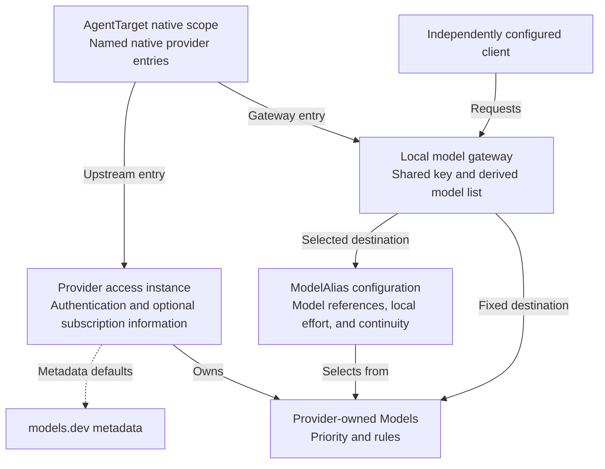

# Product design boundaries

This document explains the boundaries behind the [product contract](spec.md)
and its [vision](spec.md#vision).
Shared integration boundaries belong to [Integration support](../integrations/spec.md);
its [provider-specific contracts](../integrations/spec.md#provider-specific-contracts)
own exceptional service behavior and provider evidence.

## Decisions

The confirmed choices are a local personal tool, CLI-first access from any calling
agent, a supplementary local Web interface, subscription information, and
same-protocol gateway forwarding. Payment operations and protocol translation are
excluded. The calling agent chooses and composes operations; tmax does not embed
an assistant or an approval/workflow system.

| Pressure | Considered alternative | Decision and reason |
| --- | --- | --- |
| Two accounts must have separately addressable models | Keep accounts nested under one source and add account-qualified model syntax | One Provider per access instance; custom local IDs qualify models and select authorization in one step |
| Instances share metadata but differ in local settings | Copy complete catalog definitions into every provider | Select models.dev provider metadata and store instance-local overrides; share defaults, not credentials or routing preferences |
| CLI, Web, and optional manual edits must agree | Keep competing managed state and exported snapshots | One configuration under `~/.tmax` owns desired state; secret and runtime stores have separate responsibilities |
| Configuration must not become a task for the caller | Require a complete TOML proposal for every change | Explicit CLI operations cover every setting; TOML remains an internal persistence format, not required authored input |
| Saving desired settings differs from changing running agents | Watch every file or maintain per-field pending layers | Reload and executed management edits activate the whole valid file, including pending manual changes; native application remains separate |
| Provider setup should not reconstruct another tool's state | Import providers and credentials from existing agents | Create providers from selected metadata or explicit custom settings; inspect agents only to configure them safely |
| Agent configuration and inference forwarding are independent | Give each target a direct/gateway mode | Native provider entries refer to upstream access or the tmax gateway; one target can contain both, and the gateway needs no managed target |
| Consumers need fixed or multi-model access | Require a route for every concrete model or add a separate account pool | Concrete models map directly; model aliases list explicit qualified models selected with existing priority rules |
| Multiple agents need predictable model choices | Infer candidate groups from alias names or add per-agent priority overrides | Share model priorities and protocol-qualified model aliases; each user-defined alias explicitly names its candidates |
| Equal-priority subscriptions should have predictable use | Rotate or balance every new request | Deterministic primary/standby selection; new sessions may use another eligible candidate without moving established ones |
| Peak pricing should change future selections | Cron jobs rewrite agent configuration or interrupt sessions | Evaluate schedules when selecting a new destination; retain established conversation selections |
| Existing configuration belongs to the user | Regenerate whole agent config from tmax state | Track owned changes and compare against inputs captured within execution; unrelated settings and concurrent edits must survive |
| Clients and providers speak different APIs | Normalize all traffic through a universal message format | Forward native protocols without translation, as selected by the user; reject incompatible agent configurations |
| Metadata resembles inference controls | Convert capability fields into request defaults | Metadata never chooses request values; only explicit gateway model effort maps or alias-candidate fixed effort resolve the native effort under the [routing contract](../model-routing/spec.md#request-parameters), without changing the selected backend |
| Native login sessions are already maintained | Copy native refresh tokens into a central vault | Keep native sessions with their refresh owner and use only qualified sign-in/forwarding paths; no agent credential import |
| Usage sources have different coverage | One synthesized balance across all accounts | Keep provider observations and local observations separate; incomplete evidence must remain visible |
| A cheap alias suggests an absolute price promise | Infer one cheapest model from incomparable prices | Let users encode preferences; retain provider pricing evidence without claiming global cost optimality |
| Users want to use existing subscriptions more fully | Infer a consumption strategy or generate work to exhaust quota | Execute user-defined dynamic-priority rules under the [vision](spec.md#vision); users and their calling agents decide the strategy |
| Quota information can be incomplete or stale | Guess priority inputs or exhaustion from missing evidence | Unevaluable priority rules have no effect; only qualified, current exhaustion evidence affects eligibility |
| Quota/reset conditions must compose with existing calendars | Add an expression language or silently sum adjustments | Named ordered signal rules replace the score before the existing calendar fallback; keep finite typed predicates |
| Rule evidence can come from a source or the user's agent | Merge conflicting values or infer trust from timestamps | One explicitly selected source per scoped input; source changes invalidate current facts |
| Facts change while requests run | Fetch evidence on the inference path or create a scheduler service | Explicit refresh plus opt-in acquisition in the existing local service; admission reads a coherent fact snapshot |
| Gateway lifetime must not follow an open browser | Couple inference to the UI or enable autostart implicitly | Explicit startup runs in the background; login autostart is opt-in and depends on secure credential availability |
| Web is a local visual CLI | Add management accounts, pairing, or browser sessions | No Web authentication; trust local processes, retain loopback binding and browser-origin protections, and exclude remote publication |
| Removing an object can strand its consumers | Cascade-delete references or choose replacement models | Reject unresolved references; explicit edits and existing restore operations keep changes understandable |
| Stopping a gateway can interrupt paid work | Add a drain scheduler and automatic timeout | Stop cancels in-flight requests and reports interruption without replay; no drain queue, force path, or timeout |
| One person uses several local clients | Register clients and assign keys or model permissions | One shared gateway key and a model list derived from enabled definitions; native picker choices are not permissions |
| Provider consoles expose unrelated billing controls | Mirror their wallets, budgets, and plan-management screens | Keep access management and scoped observations; link to the console for supplier-owned controls |
| First use crosses several operations | Persist onboarding progress or infer a task plan | Help exposes capabilities and current facts; the calling agent chooses explicit operations without a workflow record |
| Callers need to inspect effects before acting | Require cross-command confirmation tokens and persisted plans | Optional same-command dry runs have no effects; normal calls execute against current state without prior approval artifacts |
| A transient request failure may repeat | Introduce automatic cooldowns, failure thresholds, and recovery probes | Record the failure without changing eligibility; retain only qualified authorization, capability, and quota exclusions |
| Historical routing must remain explainable after edits | Recompute old decisions from current configuration or store full request bodies | Capture bounded decision evidence at selection time; keep request history in memory and session bindings in separate durable state |
| Native sign-in can change shared authorization before local commit | Treat an unchanged TOML file as an unchanged login | Qualify the native commit and recovery boundary; expose partial native changes and block affected managed use |
| Alias forwarding needs one understandable continuity policy | Store per-client policies and require target registration | Each alias definition owns continuity; clients must satisfy its conversation requirements, independently of configuration management |
| Candidate removal conflicts with retained session authorization | Grandfather the historical candidate set | Block affected later turns on activation without reassignment; in-flight requests retain their snapshot |
| Direct edits should not repair unrelated OS integration | Update autostart on every save/reload | Update registration when startup intent changes or an explicit control runs; report unrelated drift without blocking edits |
| Different assistants and working directories invoke tmax | Select or search a different configuration for each caller | One personal `~/.tmax` home and authority; caller identity is not native target identity |
| Results feed subsequent operations | Require prose parsing or return all internal state on every call | Compact JSON identifies changes and their effect; detail reads expose evidence, and failures retain completed changes and recovery |
| Native login sources are needed before model setup | Require complete model selections in a joint configuration document | Register the existing target with incomplete selections; block incomplete native application, not source registration or standalone gateway use |
| Local demand can exceed capacity | Queue requests or retry another provider | Apply [bounded admission](spec.md#local-request-admission); callers own retry decisions |
| A configured upstream rejects requests repeatedly | Infer depleted quota or permanently rewrite priorities | Opt-in alias fallback plus provider-scoped fixed-duration priority replacement; no partial-response replay or session migration |
| Reasoning can remain silent while a connection or refresh can stall | One timeout for every stage | Separate [connection/credential deadlines](spec.md#transport-deadlines) from inference lifetime |
| One provider serves several native protocols | Treat one catalog URL as every protocol's base or split credentials across providers | Share [integration endpoint resolution](../integrations/spec.md#endpoint-resolution); custom bases are explicit per protocol |
| A protocol family includes stateful auxiliary operations | Forward arbitrary paths or build a resource directory | Qualify [finite operations and original resource bindings](../integrations/spec.md#supported-operations-and-resource-identity); reject unsupported use |
| Terminal and service environments differ | Inherit ambient proxy variables or silently fall back direct | One explicit [outbound policy](spec.md#outbound-network-policy), separate from native-agent networking |
| Multiple callers or an executable upgrade encounter a live service | Take over, restart, or pick another port automatically | Reuse a compatible [daemon owner](spec.md#daemon-service-identity); report incompatible or unidentified ownership |
| Local state may need external recovery | Add backup bundles, snapshots, sync, and a retirement workflow | Bound [system-backup responsibilities](spec.md#backup-and-restoration-boundary); leave independent local operations and user-owned uninstall separate |
| Several consumers need the same refreshed login | Let each refresh independently or schedule background refresh | Coordinate [one refresh per authorization generation](spec.md#credential-refresh-coordination) with guarded publication and an independent deadline |

## Product structure

Provider and AgentTarget are the principal independently managed objects. CLI
and Web share their operations and validation. Agent configuration and gateway
forwarding work independently or together.

Alias candidates are model references with optional alias-local settings, not
independently managed objects. Account and subscription facts belong to providers;
session bindings and observations are runtime state, not desired resources.

An agent's native provider entries and model choices are its configuration,
not upstream accounts or permission grants. Preview, apply, conflict detection,
and restoration act on that configuration. Removing a managed target does not
remove the gateway or revoke its shared key.

Base priorities, time schedules, and signal rules belong to concrete models,
not separate policy resources. Each model alias has a nonempty list of unique,
registered qualified candidates. IDs such as L0, L1, or coding carry no selection
semantics; only the explicit list defines membership. Concrete configuration and
gateway mappings require no model alias or duplicated route definition. The contract
is in [Model selection](../model-routing/spec.md).

The local service owns the Web interface and the optional gateway listener. CLI-only
configuration operations also work without a daemon service. Both paths share
the authoritative text configuration and serialize mutations of the same targets.
Current-user-restricted secret files and runtime records are not competing
configuration authorities. The [product contract](spec.md#configuration-authority)
owns the manual-edit and read-only agent-inspection boundaries. Gateway startup and
lifetime follow the [model-gateway contract](spec.md#model-gateway), independently of Web interactions.

The [configuration contract](../configuration/spec.md) owns TOML field syntax and
activation semantics. The service evaluates an immutable validated snapshot with
accepted catalog data. File persistence, service activation, and native application
are separate failure boundaries; reporting must preserve that distinction rather
than imply a transaction across filesystem, process, and native credential stores.

The [first-use path](spec.md#first-usable-agent) is a composition of operations,
not another owner of configuration. CLI operations and supplementary Web actions
write the same intended settings. Authentication and native application remain
explicit operations; a completed earlier effect must not be repeated merely
because a later operation failed.

The [CLI contract](../cli/spec.md) owns command syntax, help, dry-run behavior, and
result serialization. Shared results describe actual effects and supported next
actions. A dry run uses current inputs but creates no executable plan, resource
reservation, or confirmation handle. Execution inspects current state again and
checks for concurrent changes before writing. The caller decides whether to use
dry run; tmax does not treat it as proof of authorization or human judgment.

This division follows the [Agent Native Manifesto](https://github.com/suraciii/agent-native-manifesto):
expose capabilities, conditions, and observable results to the user's assistant
without requiring it to reconstruct the product through a UI. It does not require
an embedded agent, a new discovery protocol, or a certification claim.

A provider integration defines qualified authentication flows, endpoint/protocol
behavior, capability mapping, and supported usage queries. It is an integration
definition/type, not the identity of an arbitrary upstream service, account, or
local Provider. In particular, `custom` can serve unrelated services only through
their explicitly configured, independently qualified provider instances.
An agent integration owns version detection, configuration precedence, native
credential handoff, model selection, and change restoration. Neither owns the
other's schema. pi and omp must have separate agent integrations.
Each exceptional service product has one nested `spec.md` under `specs/integrations/`.
This is a documentation ownership boundary, not a new provider resource or plugin
framework. Ordinary compatible API-key endpoints reuse the shared contracts;
provider-specific authentication, entitlement, session, or protocol semantics
must be specified before that integration is advertised as supported.

These are responsibility boundaries, not a commitment to separate crates,
plugins, processes, a Web framework, or a database schema.

## Provider identity and model catalog

A provider is one configured access instance, not a vendor registry entry or an
account pool. Its custom local ID, display label, selected provider metadata, and
provider integration type have distinct roles. Provider integration type selects
qualified behavior; metadata supplies overridable defaults; the local ID qualifies
model names.

deepseek and deepseek-2 may both reference the models.dev deepseek entry while
using different authorizations and billing scopes. Another OpenCode Go subscription
similarly creates another provider instance. Each owns its authentication and
optional subscription; there is no nested Account resource or extra alias registry.
The [product contract](spec.md#providers-and-authentication) owns ID allocation and renaming.

Authentication holds the selected method and its secret reference or session
ownership. Secure storage may separate secret bytes from ordinary settings without
creating an independent API-key product. Upstream user/workspace identity is optional
metadata. Different credentials or local IDs do not prove independent billing scopes.

Subscription information is optional provider data, not a separately managed
resource. Several agents and routes may use one provider without copying its
subscription. Authentication can be missing or expired while the plan remains
visible. Absence of subscription information proves no billing state. Grouping
instances by service is a UI view, not a parent object with credentials or an
active-account pointer.

A Model is a provider-owned child identified by the local provider and exact
upstream model ID. Two providers expose distinct qualified models even when the
account or catalog metadata matches. Their priorities and schedules can differ.
Supported protocols are capabilities of one Model, not extra model identities.

The selected models.dev provider metadata is a baseline, not merely a lookup label.
Effective supported fields combine that baseline with instance-local provider and
per-model overrides. The saved configuration keeps the metadata reference and
explicit differences, not a copied catalog. Removing an override restores the
inherited value. Model enablement, priorities, schedules, subscription details,
and authentication remain explicit local settings, not metadata inheritance.

Upstream discovery may supply evidence or suggest a local change; it is not a
hidden third metadata-precedence layer. The [catalog contract](../model-routing/spec.md#model-catalog)
owns field mapping, override semantics, and adoption of metadata updates. Catalog
metadata and user overrides cannot establish unverified integration support.

The [capability projection design](../integrations/design.md) separates model
declarations, explicit gateway effort maps, shared alias inputs, native
representation, and request intent. Backend selection is independent of effort:
validate on the selected backend or reject without a replacement. This adds no
models, account pools, or capability resources.

[OpenCode's provider configuration](https://opencode.ai/v2/docs/providers/)
also distinguishes the configured provider key from the runtime package and
uses that key in model references. This is a naming precedent, not a requirement
to copy its configuration schema or assume all Agents use the same syntax.

## Provider selection

Concrete agent settings select a qualified model and therefore one provider
instance. Gateway access can use that same fixed model through a derived mapping,
or a model alias that selects among qualified models. There is no later account
selector. To group two OpenCode Go subscriptions and official DeepSeek under one
alias ID, explicitly list each provider/model pair; matching names are not enough.
Equal-priority selection remains deterministic, not round-robin or implicitly
weighted by credential count.

Native agents may have their own active-account state. An adapter must map tmax's
requested provider authorization to the real credential scope and track conflicts
between targets that share it. Native login can activate a newly added account;
command help must disclose that behavior, and dry runs and execution results
identify the affected shared scope. Supported isolation may prevent the switch.
A second local provider ID does not create isolation inside the agent.
Native sign-in and saving its reference are not one transaction. Qualification
must cover the point at which the owner changes active authorization and the
supported recovery path. The
[product authentication boundary](spec.md#providers-and-authentication) governs
partial outcomes, including native consumers outside tmax's inference control.

New instances, candidate additions, and priority changes affect future selections.
Candidate membership removal and alias continuity changes follow the
[selection contract](../model-routing/spec.md#selection-and-continuity), including
blocking affected existing sessions rather than retaining historical access.
An unavailable pinned provider cannot fall through to another instance.

## Authentication and secret ownership

| Credential path | Native upstream entry | Gateway forwarding |
| --- | --- | --- |
| Provider API key | Supported secret reference or explicit native-store handoff | Gateway resolves the selected provider's key; the agent receives only a local gateway credential |
| Native-agent login session | Native agent signs in and refreshes its session | Allowed only with a qualified native gateway contract; local authentication is separate from the forwarded upstream session |
| tmax-owned login session | Only with an explicit supported handoff that leaves one refresh owner | tmax owns login and refresh when that provider authorizes such a client flow |

The native-login gateway case is not equivalent to moving a token into a generic
API-key field. The [Codex subscription contract](../integrations/codex-subscription/spec.md)
owns its concrete gateway requirements. Native-session forwarding must bind the
expected destination and must not persist the forwarded session.
Native-session forwarding must establish the caller's upstream identity and
restrict eligible provider instances to that identity. A readable token alone is
not proof; the native gateway contract must qualify the account-identity mechanism.

Agent inspection reads only what is needed to locate targets, explain effective
scope, preview owned changes, and detect conflicts. It does not import native
providers, models, or credentials. Supported login flows may leave their session
with the native agent; this is not credential migration. Command-backed secrets
must not execute merely to render a configuration preview.

The [product secret-protection contract](spec.md#local-access-and-secret-protection)
owns supported tmax secret and recovery storage formats and file-access restrictions.
Native-owned stores remain native.

The credential owner must hide refresh coordination from inference and observation
callers. Its publication guard covers both authorization identity and credential
revision; a provider-local mutex in only one caller process is insufficient.
The [refresh contract](spec.md#credential-refresh-coordination) owns cancellation,
deadline, and replacement behavior. It does not transfer native ownership.

## CLIProxyAPI reference

[CLIProxyAPI's example configuration](https://github.com/router-for-me/CLIProxyAPI/blob/0db19025571684b198a2ef508f99b41c717337e8/config.example.yaml)
groups upstream keys and model mappings under providers. Its
[Auth records](https://github.com/router-for-me/CLIProxyAPI/blob/0db19025571684b198a2ef508f99b41c717337e8/sdk/cliproxy/auth/types.go)
normalize key-based and file-backed authorizations; its
[selectors](https://github.com/router-for-me/CLIProxyAPI/blob/0db19025571684b198a2ef508f99b41c717337e8/sdk/cliproxy/auth/selector.go)
choose eligible records independently of the client-facing model ID.

tmax retains the distinction between downstream authentication and upstream
authorization but does not copy CLIProxyAPI's pooled-authorization product model.
Each tmax provider is independently addressable through qualified model names;
dynamic selection uses those candidates. Credential count is not subscription
count. Protocol conversion and hidden replay remain excluded. The reference's
`access.api-keys` authenticate downstream clients; tmax upstream keys remain
inside provider settings. Native-agent refresh ownership remains independent.

## Applying and restoring agent changes

A change proceeds through these boundaries:

1. Detect the target version, effective scope, overriding settings, and shared
   files or auth stores. Capture a content snapshot of the managed inputs.
2. Check the desired configuration against provider and agent capabilities and
   compute the minimal owned changes, credential exposure, and reload requirements.
   A dry run returns that description without writes or retained execution state.
3. During actual execution, recheck captured inputs before mutation and reject
   concurrent changes. Serialize writes to shared native files. An earlier
   dry run does not supply the execution snapshot.
4. Retain current-user-restricted plaintext recovery information, write owned
   changes with per-file replacement, and validate the resulting target
   configuration. Native CLI or credential-store actions need their own
   documented recovery semantics.
5. Record applied state separately from runtime verification. A restart-dependent
   agent remains awaiting reload until its effective state is confirmed.

Multiple files and an external agent credential store do not provide a single
atomic transaction. Interrupted operations must be recoverable and visibly
incomplete rather than hidden behind an all-or-nothing claim. Restoration is a
three-way comparison of prior values, tmax-applied values, and current values.
An edit to a managed field after application is a conflict, not permission to
replace the whole file with an old backup.

Before applying any native gateway entry, require an explicitly started and ready
listener. Upstream entries check prerequisites without starting inference or
issuing a paid probe. Saving either kind does not apply native files.
None of these operations kills a conversation or revokes a native session as an
incidental step.

## Gateway forwarding contract

The initial protocol families are OpenAI Responses, OpenAI Chat Completions, and
Anthropic Messages. Additional provider-native protocols require a separate
explicit support contract. The gateway must not claim support for every protocol
that an agent or provider happens to implement.

The shared integration contract owns [endpoint resolution](../integrations/spec.md#endpoint-resolution)
and [operation/resource identity](../integrations/spec.md#supported-operations-and-resource-identity).
Native configuration and forwarding consume the same resolved base. Neither a
transport adapter nor the router maintains a competing endpoint table. Request
dispatch uses declared operations, not unrestricted path concatenation.

The router derives fixed concrete mappings from enabled models, with no
client-permission filter or separate publication list. Model aliases supply a
public ID, protocol, explicit candidate list, and continuity policy.
The [selection contract](../model-routing/spec.md) resolves alias candidates and
their priorities under one snapshot; concrete access stays fixed. Established
conversations retain their selection, and in-flight execution never changes at
a time boundary. Request handling never creates management configuration.

The gateway forwards provider-native payloads. It may resolve an alias, use a
configured upstream path, and perform the documented authentication/header
handoff. It must preserve native tool and stream structure rather than parse
messages into a universal intermediate conversation representation.

Transport support is explicit. HTTP streaming is not proof of WebSocket support.
An agent that requires an unimplemented transport must be configured to a
supported native transport if the agent permits it, or the configuration change is blocked.
Cancellation, stream termination, and partial usage must be exercised through
that actual transport before it is advertised as verified.

Known semantic incompatibilities must be detected without silently repairing the
request. For example, an upstream that ignores `previous_response_id` cannot
serve an agent configuration that relies on server-side continuation. tmax must not fetch or
invent missing history to hide this incompatibility. Unknown vendor extensions
remain opaque; they are not proof of compatibility and must not be silently
removed.

Provider-issued opaque IDs cannot be reliably classified just by their spelling.
Changing an agent configuration's provider or upstream identity therefore requires
a new conversation or a qualified agent-native reset. Where tmax cannot establish
a safe continuation, it must block the switch rather than infer state ownership.

Local gateway authentication is stripped before forwarding. Upstream secrets are
attached only to the selected provider instance's configured destination. Neither
an incoming model name nor an incoming header may choose an arbitrary upstream
URL. Authenticated upstream calls use verified TLS, except an explicitly local
custom endpoint whose trust boundary is shown to the user.

Transport execution owns bounded admission, incremental backpressure, connection
deadlines, and the captured outbound policy under the
[product contract](spec.md#local-request-admission). It must not encode those
mechanisms as model-selection rules. Credential acquisition has a separate
deadline from connection setup and inference streaming. A shared HTTP client
must not leak its connection/credential deadline into an inference lifetime.

Daemon ownership coordination is separate from inference admission and native
application. The [service-identity contract](spec.md#daemon-service-identity)
requires one current owner before any daemon state is mutated. Ownership
records are evidence to validate, not permission to kill a process or reuse a
stale PID. Stopping inference does not remove the management surface.

## Observations and local operations

Provider usage fetchers return dated observations of the upstream account, not
a mutable universal credit balance. Each observation identifies the local provider
and upstream billing scope when known. Subscription allowances, rate limits,
API prepaid balances, and renewal dates remain distinct. Provider-console control
and display exclusions follow the [billing scope](spec.md#billing-quota-and-renewal-information).

Read-only provider or native-agent usage interfaces may supplement a provider
without a public usage API. Each integration must label that evidence and its
version dependency. An unsupported website-internal endpoint must not quietly
become a guaranteed quota feature.

The [input contract](../model-routing/inputs/spec.md) separates provider-scoped
input definitions from their current facts. Explicit refresh and recording work
without a service. Configured automatic acquisition is a bounded responsibility
of the existing service, not an inference-time fetch, retry framework, or
independently managed scheduler. Source failures preserve a still-valid fact only
within its original validity; input publication never rewrites desired priorities.

The [diagnostics contract](../diagnostics/spec.md) owns request-record fields,
evidence scope, retention, and cleanup. Selection captures evidence from the
same decision used for forwarding. The display must not reconstruct a historical
decision by running today's rules. State readers return allowlisted summaries,
not serialized provider adapters, credential objects, raw errors, or payloads.

Bounded in-memory request history is distinct from durable session bindings,
applied-state recovery information, and provider quota observations. Clearing
that history or restarting the gateway cannot release a destination or revoke
credentials. Retained-record aggregates describe only retained coverage, not
an account-wide or lifetime bill. No disk request archive or body-capture mode
is part of this design.

Provider-reported usage and observed usage are never summed. Selection follows
configured priorities and the scoped evidence in the
[selection contract](../model-routing/spec.md#selection-and-continuity).
Transient failures do not introduce a second routing policy through diagnostics.

## Decisions reserved for implementation design

The [configuration contract](../configuration/spec.md) fixes TOML syntax, metadata
overrides, secret references, and save/reload/apply behavior. The
[CLI contract](../cli/spec.md) fixes target command grammar and machine-readable
outcomes. Runtime implementation must qualify native version ranges,
credential-store access, platform startup integration, and transport compatibility.
The [diagnostics contract](../diagnostics/spec.md) fixes retention semantics;
implementations must measure and document concrete finite history-capacity limits.
The same measured-evidence requirement applies to active-request, body/buffer,
connection, and credential-deadline limits. These values must be finite where
required by the product contract, not copied from another gateway's defaults.
Management HTTP paths remain implementation-facing details, constrained by the
shared operation and local browser-protection contracts.

These implementation and integration obligations do not permit weakening the
product contracts or adding protocol conversion. The target command grammar and
configuration example are not evidence of provider entitlement or end-to-end
native-route qualification.
