# Session portability design boundaries

This document owns the boundaries and evidence behind the
[Agent session portability contract](spec.md). Shared Agent qualification belongs
to [Agent integration](../integrations/spec.md). This capability is not part of
native configuration management and does not change the
[product structure](../product/design.md#product-structure).

## Decisions

| Pressure | Considered alternative | Decision |
| --- | --- | --- |
| Conversations are locked into each Agent | Build a central transcript store or continuously synchronize native stores | List native sessions read-only; import creates one new native session. tmax stores no transcript copy and never syncs. |
| Several native formats and versions differ | Pairwise converters for every source/destination pair | One canonical visible-history representation with version-qualified readers and writers. Pairwise conversion would multiply drift and hide unsupported fields. |
| Tool vocabularies differ across Agents | Recreate structured tool calls in the destination vocabulary | Preserve tool activity as non-replayable text. Structured replay would fabricate native execution history and require unverified semantic mapping. |
| A written transcript may not appear or resume | Treat file creation as a completed import | Require the destination Agent's own discovery and readback verification. Native visibility is part of the transaction boundary. |
| Imported history may exceed the destination context | Silently truncate or ask a model to write a handoff brief | Use a deterministic budget, explicit recent-turn selection, or fail. Never generate or infer conversation content. |
| Repeating an import can create duplicates | Deterministic destination IDs or overwrite-by-source | Keep a bounded Import record; default to a conflict; explicit `--again` creates another copy. Never overwrite. |
| Targets can resolve to the same native store | Key provenance and conflict detection by target ID | Key Import records by source/destination store plus native ID; target IDs and paths remain metadata. A shared store must not bypass repeat detection. |
| Native stores may be live, locked, or shared | Write every format directly | Prefer an official native import operation. Otherwise use a qualified writer and reject same-store, active, or unsafe destinations. |
| Imported sessions raise ownership expectations | Manage imported sessions as tmax resources with restore and cleanup | The destination Agent owns the imported session. tmax keeps only provenance and repeat-detection metadata. |
| Search and transcript browsing look adjacent | Add an index and a full transcript UI | The initial contract lists metadata and imports one selected session. Search, previews, attachments, and editing stay outside the boundary. |

## Ownership and flow

```mermaid
flowchart LR
    A["Source Agent target<br/>native session store"]
    R["Version-qualified reader"]
    C["Canonical visible history<br/>one branch, no hidden state"]
    S["Budget and fidelity selection"]
    W["Version-qualified writer"]
    B["Destination Agent target<br/>new native session"]
    V["Destination reader<br/>visibility and readback"]
    P["Import record<br/>bounded provenance"]

    A -->|read-only snapshot| R
    R --> C
    C --> S
    S --> W
    W --> B
    B --> V
    V -->|verified| P
```

The source store is never a write target. The tmax configuration file is not
involved. The Import record is not a second transcript and does not make the
destination session a tmax-managed object.

This capability covers the six Agent integrations owned by tmax. Formats from
other coding tools cited below are external evidence, not supported session
targets until a separate Agent integration and qualification exist.

## Native store evidence

These are observed native storage shapes from specific installed builds, not a
version range, schema license, or promise that every build reads and writes them.
They are evidence used to qualify adapters; the normative contract is the
version/schema policy below, and no core rule requires these filenames, tables,
fields, or flags. The version labels identify the observed build only; they are
not a support gate or an inferred range.

| Observed build (evidence) | Adapter-resolved store | Observed shape (evidence) | Import write path |
| --- | --- | --- | --- |
| Codex CLI 0.162.1 | `CODEX_HOME/sessions/<YYYY>/<MM>/<DD>/rollout-*.jsonl` plus an observed native thread index in a `CODEX_HOME/state_*.sqlite` database; archived and compressed idle rollouts are version-qualified | Rollout JSONL plus index rows carrying cwd, title, archived state, timestamps, a history mode, and a rollout reference; exact table and column names are build-specific | New rollout plus version-qualified native index/registration; direct writer qualification required, and desktop-app registration is not implied |
| pi 1.5.2 | Default `<agent-dir>/sessions/<encoded-cwd>/<timestamp>_<uuid>.jsonl`; `--session-dir`, `PI_CODING_AGENT_SESSION_DIR`, or `sessionDir` can relocate the root | Append-oriented JSONL tree with a session header carrying cwd; nested subagent artifacts are not primary sessions | New file under the resolved session root and effective cwd bucket; the adapter's native header/metadata path must carry the effective cwd |
| omp 18.19.0 | `<profile-agent-dir>/sessions/<encoded-cwd>/<timestamp>_<uuid>.jsonl`; `--session-dir` or `PI_CODING_AGENT_SESSION_DIR` can relocate the root | Title slot plus session header carrying cwd and optional additional workspace roots; nested review/subagent files are not primary sessions | New file under the resolved session root and effective cwd bucket; adapter-owned header fields must carry the effective cwd; additional roots are not imported |
| OpenCode 2.0.28 | Data-home or `OPENCODE_DB` SQLite; current and legacy session schema families were both present | The current session row carries its own directory; project/worktree rows are broader grouping. The installed client returned only the current schema; legacy rows remained | Official native session import when the installed CLI supports it; direct database writes are not initially qualified |
| Hermes Agent 0.22.1+683.g848fc0a | `HERMES_HOME/state.db`; session and message tables | Session cwd is nullable; archived, hidden, pinned, parent, usage, and activity fields exist. Native listing is source-scoped and hides unnamed/current rows by default | Not initially qualified; read-only discovery |
| DSH 0.2.2-rc.1 | `<DSH_HOME>/sessions/<projectKey(cwd)>/session-<uuid>/<generation>.jsonl.zstd`; custom root is native-configured | A compressed generation log with a session header carrying cwd; `projectKey` escapes non-path-safe characters and truncates, with a no-cwd fallback. A projection cache and workspace store are auxiliary views | Not initially qualified; read-only discovery |

Consequences:

- Codex needs both a rollout and the qualified native index/registration. A
  rollout file alone is not evidence that the native client can discover the
  session. The adapter must not assume one state-database filename or table name.
- OpenCode needs a resolved database/server binding, not a configuration filename.
  Current and legacy schema families can coexist; the adapter selects the
  qualified schema and does not union them into duplicate rows.
- pi and omp tree files need one visible branch selection; importing every record
  could create abandoned branches or an ambiguous current leaf. Their nested
  subagent/review artifacts must not be enumerated as primary sessions.
- OpenCode and Hermes read SQLite; an import writer must use a transaction or the
  native import path. A live writer must not be raced.
- DSH needs generation discovery, decompression, and event sequencing, not a
  hardcoded current generation. It remains read-only until framing and checksums
  are qualified for a writer.
- The installed pi, omp, and DSH builds above are newer than some native
  configuration references. This is evidence of drift, not a supported range;
  session adapters require their own compatibility matrix and fixtures.

## Version and schema policy

The session contract is version-agnostic. Version-specific knowledge lives in the
target adapter, never in core list/import rules or in a shared path encoder.

- A reader declares the bounded schema signatures it can read. It probes metadata
  and schema identity rather than trusting only a binary version string or a
  filename. An unrecognized schema yields `unsupported`/`unsupported_version` for
  that target or session; other targets stay readable.
- A writer is enabled only for an exact qualified schema and native registration
  path. Unknown columns, files, fields, or encodings fail closed before native
  writes. There is no generic SQLite, JSONL, or path-encoding writer fallback.
- Unknown fields are tolerated on read; only adapter-mapped fields enter canonical
  history. Semantics are never inferred from a field name or another Agent's
  shape. Listing uses a read-only snapshot or native read API and never runs a
  migration, schema repair, checkpoint, or vacuum.
- When a store exposes index, file, or cache views of the same sessions, the
  adapter chooses one authoritative representation and deduplicates by native ID.
  It does not multiply rows or merge conflicting metadata.
- Legacy and migrated layouts are separate read-only schemas. Presence of an old
  table, directory, or file is not proof that it is current.
- Native CLI flags, SQL table names, and file patterns cited in this document are
  evidence from the observed build, not a stable API. An adapter may use a native
  library, database, or API that provides equivalent discovery.
- Each supported schema has a compatibility entry and fixtures. Adding or removing
  a version changes adapter data and tests, not the product contract. An Agent
  name does not imply a schema: two builds of the same Agent may require different
  adapter entries.

## Working directory and discovery

The primary session working directory is native metadata, not a property derived
from the store path. pi, omp, and DSH encode cwd into a directory name, but their
formats also carry cwd in the session header, and those encodings differ. Codex
stores cwd in the rollout header and the native index. OpenCode stores it in the
current session row's directory. Hermes stores a nullable `cwd`. The reader must
use the metadata value; decoding a directory name is not authoritative.

The encodings are not interchangeable. pi removes the leading separator and wraps
the remaining resolved cwd in `--`, replacing `/`, `\`, and `:` with `-`. omp uses
`-<home-relative>` under the home directory, `-tmp...` under the temp root, and a
legacy `--<absolute>--` form outside both, after canonicalizing equivalent paths.
DSH builds a project key that escapes non-path-safe characters and truncates, with
a no-cwd fallback. These are observations, not a shared algorithm. A writer must
use the resolved version-qualified encoder or native creation API; a reader must
use the native cwd field, not decode a directory name.

The following discovery behavior is evidence from the observed builds, not a
required field name or CLI flag. An adapter may use a library, database, or API
that provides equivalent behavior.

| Agent | Observed primary cwd source | Observed discovery behavior |
| --- | --- | --- |
| Codex | Native index cwd, with rollout session metadata as the legacy fallback | Default resume is cwd-filtered; an all-session view is available and exposes a CWD column |
| pi | Session header cwd; default path is encoded from resolved cwd | Local session listing is cwd-scoped; a global listing exists; cross-project resume may fork into the current cwd |
| omp | Session header cwd plus optional additional workspace roots | A global scan of project buckets exists; a missing cwd can trigger a relocation/fork flow |
| OpenCode | Current session row's own directory; project/worktree rows are broader grouping | Native listing is current-project only; the official import accepts a destination directory |
| Hermes Agent | Session cwd, nullable; repository root is separate | Native listing is source-scoped and hides unnamed/current rows by default; resume restores cwd when present and warns without failing when it is gone |
| DSH | Session header cwd; project key groups the store | Session persistence lists stored sessions; the workspace store is an auxiliary grouping view |

Observed multi-root metadata is not uniform: Codex rollouts can carry additional
workspace roots, omp session headers can carry extra roots, OpenCode projects can
expose directory/worktree rows, and DSH workspace storage groups paths with
session IDs. These are native workspace state, not a canonical history field. The
contract preserves only the primary cwd and reports additional roots as omitted.

Decisions:

- **Primary cwd only.** Additional workspace roots are native workspace state,
  not canonical visible history. An import preserves the primary cwd and reports
  the omitted additional-root count.
- **Inventory, not picker.** Archived, hidden, and unnamed native-readable rows
  are listed and flagged; native current/unnamed/archived filters are not applied.
- **Verbatim metadata.** List returns the recorded cwd. `--cwd` compares after
  lexical normalization under host path rules only; it does not resolve symlinks
  or match additional roots. A cwd that is absent, null, or ambiguous is excluded
  from a cwd filter and reported as `cwd_unknown`.
- **No fallback.** Import uses the source cwd or explicit `--cwd`; it never falls
  back to the destination target or process cwd. Without explicit `--cwd`, a null,
  missing, or ambiguous source cwd fails; a missing selected directory fails
  before native writes.
- **Destination project context is native.** The effective cwd may activate the
  destination Agent's project instructions, settings, trust, sandbox, and tool
  permissions. tmax copies none of that context and does not vouch for it.
- **Discovery must be scoped deliberately.** Verification uses an all-session
  reader or a scope containing the effective cwd. Absence from a cwd/project
  filtered picker is not a failed import.
- **One target, one store.** The adapter resolves the target's native home/profile
  and session-root selectors. If they do not identify exactly one store, the
  operation fails instead of guessing. For OpenCode, the database/server binding
  is part of the target resolution and cannot be inferred from a config filename.

## Open-source reference patterns

These projects are external evidence, not tmax qualification or endorsement.
Only patterns are borrowed; no code or format claim is copied.

| Project | Pattern | Adopted or rejected |
| --- | --- | --- |
| [Continuo](https://github.com/yoavf/continuo) | Reads native session files read-only, writes only its own tracked mirror, refuses to overwrite, uses the official OpenCode import, excludes hidden provider reasoning, and switches between full transcript and handoff brief | Adopt read-only sources, provenance, explicit conflict handling, and official import. Reject a tmax-owned mirror and generated handoff briefs. |
| [Baton](https://github.com/Kaseban/baton) | One canonical `Session` representation with text, reasoning, tool calls, and tool results; `list`, `convert`, and `import` operations; explicit conflict modes; full transcript benchmarked above a summary | Adopt a canonical representation with a narrower portable field set, list/import separation, and full-history preference. Reject automatic Agent launch/import and structured tool replay until separately qualified. |
| [UniSessions](https://github.com/vibheksoni/session-export) | SDK-first stores and converters, dry-run by default, explicit conflict modes, official OpenCode export/import, local FTS index | Adopt stores/readers/writers and explicit conflict modes; keep dry run optional under tmax's shared CLI contract. Defer the search index and broad conversion matrix. |
| [resume-from](https://github.com/alexei-led/resume-from) | Preview-first handoff; source never changes; strips vendor state and tool-result bodies; budgets history to the target context; pins the first prompt and recent turns | Adopt preview, source immutability, context budget, and pinning. Reject per-Agent plugin shims and implicit launch. |
| [Codex Session Bridge](https://github.com/leNing-sy/codex-session-bridge) | A transcript alone is not enough; Codex needs a rollout and index registration; hidden thinking and tool chains are not replayed; default skip; atomic writes and verification | Adopt native registration, readback verification, atomic/conflict behavior, and hidden-state exclusion. Reject unqualified desktop database writes. |
| [Agent Sessions](https://github.com/jazzyalex/agent-sessions) | Read-only local discovery across many Agent versions; explicit unavailable states; compressed and versioned formats; no upload | Adopt read-only discovery, state reporting, and local-only processing. Defer its search UI, quota meter, and broad source registry. |
| [OpenMemory](https://github.com/mem0ai/openmemory) | Omni-directional porting with preview and per-session selection; autosync is only a roadmap item | Adopt preview and selection. Reject autosync from the initial contract. |

The shared lesson is consistent: native files are read-only inputs; conversion
needs a canonical model; the destination must own the written session; hidden
provider state is not portable; and target visibility is part of success.

## Fidelity boundaries

| Content | Why it is excluded or transformed |
| --- | --- |
| Visible user and assistant text | The only portable conversation content. Preserve order and text. It is untrusted source content; instructions and tool output are not sanitized, and the destination Agent's system context remains authoritative. |
| Compaction summaries | Useful context, but only portable where the destination has a native summary representation. A synthetic summary message would change roles and instructions. |
| Tool calls and results | Tool names, schemas, and results are Agent- and version-specific. Preserve a bounded digest; never recreate executable native calls or replay results. |
| Hidden reasoning | Provider-owned, often encrypted or non-replayable. Excluding it also avoids presenting private chain-of-thought as another Agent's history. |
| System, developer, harness, and environment context | The destination Agent supplies its own. Source-injected context can contain instructions, secrets, or stale environment facts. |
| Native credential fields, authorization headers, and login sessions | Agent-owned and outside the transcript contract. Omit structured credential state; secrets embedded in visible text or tool output are copied as recorded and are not guaranteed to be detected. |
| Approvals, sandbox, permissions, worktree, and process state | Belongs to the source runtime. The destination cannot safely inherit it. |
| Usage, cost, token counts, and billing evidence | Source-specific observations, not conversation content. They would be misleading in another Agent's history. |
| Attachments, images, and audio | Native representation and size differ. Defer until each reader/writer pair has a qualified mapping. |
| Parent, child, subagent, and forked-session links | The selected session is imported standalone. Copying links to sessions that were not imported would create broken or misleading relations. |

## Qualification boundaries

- A reader may support listing without supporting import. An unsupported version
  remains visible as a state, not silently omitted.
- Listing uses metadata and bounded reads. Exact message or tool counts are null
  when they cannot be derived without an unbounded transcript parse.
- Listing and import readers enforce documented source size and record limits.
  An oversized source fails without effects; it is not silently truncated.
  Compressed or framed sources are decompressed under the same bound, so a
  decompression bomb is an oversized source.
- Import records are bounded by count and bytes. Pruning may lose repeat detection
  or an `imported_from` annotation for an old import, never a native session.
- A writer is qualified only when it can create, register, and read back a session
  through the destination Agent's own discovery path.
- Official native import operations are preferred over direct writes because they
  preserve the Agent's own index and validation behavior. An official importer
  must be directed at the destination target's resolved store and run
  non-interactively; if it cannot be scoped or run without interaction, the
  destination is not qualified.
- An official source export or read operation may be used when it is read-only,
  scoped to the source target's resolved store, and non-interactive. It is not
  proof that another Agent version or store shape is readable.
- A file-based writer may create a new session while the Agent is running only
  when the format is append-only and the destination discovers new files without
  rewriting existing state. The result reports any required reload.
- A SQLite writer must use a transaction and must not race a live writer. If that
  cannot be established, the destination is blocked.
- Desktop application state databases, browser sessions, and cloud/account
  indexes are not inferred from a CLI rollout store. A CLI-owned index, such as
  Codex's observed native thread index, may be part of the qualified reader or
  writer when source inspection establishes that role.
- Version evidence is pinned to concrete observed builds. A parser accepting one
  file does not establish a version range.

## Reserved decisions

These are intentionally outside the initial target contract:

- structured tool-call replay for a future explicitly qualified pair;
- attachment, image, audio, and file-snapshot migration;
- selecting a non-latest branch or importing a session graph;
- importing two copies into the same store or forking a session in place;
- user-selected destination models when the destination's native model set is
  unknown;
- transcript preview or search in the local Web interface;
- background indexing, autosync, or cross-machine transfer.
