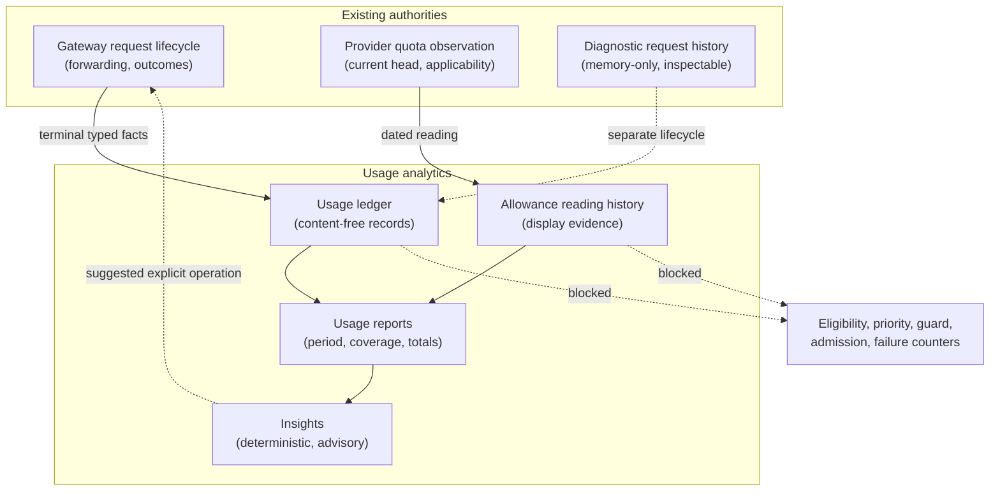

# Usage analytics design

**Authority**: This document owns the boundaries, invariants, and trade-offs of
usage analytics. The [spec](spec.md) owns observable behavior. The
[product contract](../product/spec.md#billing-quota-and-renewal-information)
owns billing scope and cost-estimate boundaries; [diagnostics](../diagnostics/spec.md#session-only-bounded-history)
owns diagnostic history bounds; [model selection](../model-routing/spec.md#selection-and-continuity)
owns quota observation use and eligibility.

## Laws

1. **Content-free retention.** A usage record contains typed usage facts only. It
   carries no request identity, decision evidence, content, credentials, upstream
   account identity, or native session identity. The ledger cannot become a
   request archive, an inspectable request history, or a conversation store.
2. **Bounded and local.** The ledger and allowance readings have age-based
   eviction eligibility and finite row and byte bounds. They stay under
   `~/.tmax/usage`, are readable only by the current operating-system user, and
   never leave the machine.
3. **Never a bill.** Observed usage is not account-wide usage. A cost estimate is
   a locally computed estimate at a frozen effective price. Provider-reported
   usage, subscription charges, and observed usage stay separate and are never
   added or subtracted into a remaining balance.
4. **Unknown stays unknown.** Unknown, partial, and ambiguous counters never enter
   a total as zero. A known zero, an unknown value, and an absent record remain
   distinguishable in every result.
5. **Gateway-only coverage.** Direct entries, unmanaged clients outside the
   gateway, other gateways, and Agent session files are unobserved. The product
   does not reconstruct sessions, projects, turns, or five-hour blocks.
6. **No routing feedback.** The ledger, allowance readings, reports, and insights
   never affect admission, eligibility, priority, guard, suspension, failure
   counters, or configuration. Reading history is display evidence only; the
   current quota observation remains the only current allowance fact.
7. **Advisory insights.** Insights are deterministic, pull-based, evidence-bound,
   and never applied. They express no budget, spending ceiling, alert, anomaly
   detection, or learned recommendation.
8. **Write isolation.** A ledger write is a bounded side effect of a terminal
   request; a reading write is a bounded side effect of a published observation.
   Neither belongs to forwarding or observation semantics, and a failure to write
   never fails, delays, retries, or replays a request or an observation.
9. **Read purity.** Reports and insights never start a service, observe a
   provider, refresh credentials, mutate data, or change routing. CLI reads remain
   available while the service is stopped; Web reads use the existing local
   service.
10. **One accounting authority.** Cost is computed once, when the record is
    written, from the effective price then in force. No later read, price change,
    or report recomputes a retained estimate.

## Placement

The gateway daemon already exists and writes the ledger as part of request
completion. An explicit paid probe appends its own record from the CLI process,
and a published allowance observation appends its readings at the publication
boundary. These are bounded, best-effort appends; none introduces a new process,
scheduler, background observation, or remote surface. The CLI reads the store
directly and never starts the daemon. The Web reads the same store through the
existing local service. Neither read observes a provider or mutates data.

## Storage boundary

The chosen store is one embedded SQL database file
`~/.tmax/usage/usage.db`, using write-ahead logging.

| Property | Boundary |
| --- | --- |
| Writers | The gateway daemon's request-capture queue, an explicit paid probe in the CLI process, allowance-reading publication, and an explicit `usage clear`. Each is a bounded best-effort writer; no other writer exists. |
| Readers | The CLI opens a read-only connection; the Web reads the same store through the existing local service. Write-ahead logging lets both proceed while the daemon writes. |
| Coherence | One report holds one explicit read transaction from its first aggregate read to its last, so totals, gaps, and readings describe one committed snapshot; a concurrent commit is either fully before or fully after it. |
| Durability | A committed record survives a process restart. A crash may lose only uncommitted batched records; the loss is reported as an unknown restart gap, never as a fabricated count. |
| Schema | The store carries an integer schema version. Unsupported newer versions and corrupt stores are typed unavailable, never empty. |
| Privileges | The directory and file are restricted to the current operating-system user. File permissions are not encryption. |
| Independent lifecycles | The store is separate from the in-memory request history, the error log, observations, input heads, session bindings, recovery state, and settings. Clearing one never clears another. |

Batched writes use a bounded queue and periodic commits. An explicit probe or
reading append is one bounded direct transaction and never enters the request
path. A full queue or failed commit drops records and increments a dropped
counter. Retry pressure must not reach the forwarding or observation path.

Pruning runs on a write path (daemon batches and explicit appends) or during an
explicit clear. A report reflects rows that still exist, including rows that
became eviction-eligible but were not yet pruned; the report states the actual
retained range and any delayed enforcement. A read never prunes.

`usage clear` runs one transaction, so readers observe either the pre-clear or the
post-clear ledger. Records committed after the snapshot remain, and the result
reports them as retained.

### Why this store

The alternatives were rejected for these reasons:

| Alternative | Rejection |
| --- | --- |
| Append-only JSON lines | No indexes, SQL, or safe concurrent read/write. Every report parses the whole file, grouping and percentiles are hand-written, and retention rewrites the file. |
| Embedded time-series engine | No mature, cross-platform, multi-process embeddable engine in the available ecosystem. The mature engines are service binaries, which would add a second service and contradict the no-new-daemon boundary. |
| Embedded key-value store | No SQL grouping, time bucketing, or percentiles; multi-process semantics and secondary indexes must be built by hand. |
| Analytical column store | Single-process or batch-oriented. The daemon writes continuously while readers query, which the shape does not support. |

A dedicated time-series engine buys compression and pre-built rollups. The ledger
does not need them at single-user scale: an indexed, append-only row table with
time-range scans and `GROUP BY` is time-series storage for this product. If data
volume later proves the need, per-day rollup tables fit inside the same store
without changing the product contract. No engine abstraction layer is introduced
now.

## Capture boundary

One terminal request produces one record. An in-progress request is excluded until
it terminates. Retries and fallbacks are part of the request's history and
outcome, not separate records; the record keeps the final outcome and destination.

Counter normalization is protocol-scoped. Each protocol recognizes one naming
family for the exclusive buckets:

| Protocol | Input | Output | Cache read | Cache write |
| --- | --- | --- | --- | --- |
| Chat Completions | `prompt_tokens` | `completion_tokens` | not recognized | not recognized |
| Responses | `input_tokens` | `output_tokens` | not recognized | not recognized |
| Messages | `input_tokens` | `output_tokens` | `cache_read_input_tokens` | `cache_creation_input_tokens` |

A counter name outside the protocol's recognized set is not used. When a
recognized and an unrecognized competing value would both affect one priced axis,
that axis is `ambiguous` and neither value enters a total.

Provider token semantics differ: some providers count cached prompt tokens inside
their input counter and some report them separately. The product must not subtract
one from the other, invent a cache counter, or price a cache axis for a protocol
whose cache counters are not recognized. The input estimate therefore prices the
reported input counter and states that it may overstate when the provider includes
cached tokens. When a recognized counter set is complete and unambiguous the record
is `reported`; a partial, truncated, or mixed set is `partial` or `ambiguous`.

Cost uses only the priced axes that have recognized exclusive counters. The price
axes `reasoning` and `cache_storage` have no observed counter, so they are reported
as unpriceable. A per-provider estimate never combines with another provider's
estimate, and it never combines billing scopes: a provider entry whose retained
records span more than one billing kind reports no estimate
(`mixed_billing_scope`) instead of adding subscription, API, and unknown scopes.

Effective price resolution, freezing, unpriced counts, currency separation, and
the API-equivalent subscription label are specified by the [spec](spec.md) and the
[product billing contract](../product/spec.md#billing-quota-and-renewal-information).

## Report boundary

A report is a read-time projection over records and readings. Nothing derived is
stored; there is no second, lossier copy of the truth.

| Computation | Boundary |
| --- | --- |
| Period | Trailing local calendar windows ending at the report instant, or an explicit instant range; stored instants remain UTC. Exact kinds and membership timestamps are owned by the spec. |
| Coverage | The report clamps to retained rows and reports retained range, reportability, evictions, dropped writes, clears, restart loss, and out-of-coverage requests once per result, with the retention horizon and delayed enforcement. Allowance reading range, count, evictions, drops, and gaps are reported separately. |
| Grouping | One dimension per report row. An unknown value is an explicit unknown group and is never filled from current configuration. Grouping never substitutes for coverage disclosure. |
| Percentiles | Population, nearest-rank method, and minimum sample size are owned by the spec. The product applies no interpolation, smoothing, or borrowing from another period. |
| Readings | Paired as separate facts with their binding handles; comparisons stay inside one binding and scope. No subtraction into remaining allowance and no conversion into observed usage. |
| Gaps | Any eviction, drop, clear, restart loss, or out-of-coverage request appears as a typed gap and is not silently absorbed; an unreadable or unsupported store is unavailable coverage instead of a gap. The gap list is bounded and severity ordered, and `reportable` states the part of the requested period that retained records can cover. |

The product must not convert an allowance reading into a token budget, derive a
hidden absolute limit from percentage movement, or infer exhaustion from observed
usage. Those conversions violate the [billing
contract](../product/spec.md#billing-quota-and-renewal-information) and the
[quota observation](../../CONTEXT.md) term.

## Insight boundary

The rule set is fixed and small. Each rule has one documented threshold set, one
evidence requirement, and one stable refusal reason when it cannot fire honestly. A
rule below its threshold reports `below_threshold`; a rule is omitted only when no
scope in the report can supply its evidence, and an applicable scope with
insufficient evidence is a refusal. The result separates fired insights from
refusals. Rules read only reports and readings; they do not read configuration,
credentials, request history, or provider consoles.

`quota_pace` evaluates these conditions in order and reports the first failing
reason: fewer than two comparable readings for the binding and window
(`single_reading`); readings exist but their binding handles differ
(`binding_changed`); the ledger does not cover the interval
(`window_before_coverage`); a known coverage gap may fall inside the evaluated
reading interval (`coverage_gap`); the basis cannot convert observed tokens to
window share (`unknown_basis`); share movement is below one percentage point
(`low_usage`); no qualified reset exists (`no_reset_clock`); the basis is credit or
the observation declares credit consumption (`mixed_credits`).

The suggested action is a canonical operation with arguments, or external
guidance. No insight may apply its action, prefill an unconfirmed mutation, or
appear as a notification, budget, alert, or spending control.

Rejected extensions: hidden-limit calibration, five-hour block reconstruction,
per-session and per-project cost, anomaly detection, learned recommendations,
budgets and spending caps, and alert delivery. Each would either invent evidence
or contradict the existing product boundaries.

## Non-goals

- Agent session-file reading, direct-traffic coverage, and cross-machine or remote
  usage aggregation.
- Request bodies, headers, URLs, prompts, completions, tool arguments, transcripts,
  or request-identity retention.
- Telemetry, upload, sync, publication, or remote access.
- Budgets, spending ceilings, rate limits, quota wallets, and alert channels.
- Cost reconciliation against provider invoices, hidden-limit derivation, and
  provider-plan tables.
- Per-session, per-project, per-turn, subagent, or five-hour-block reporting.
- Replacing diagnostic request history or the error log.

## Implementation status

The [product implementation status](../product/spec.md#implementation-status)
remains applicable. This document is a design contract, not a release claim.
