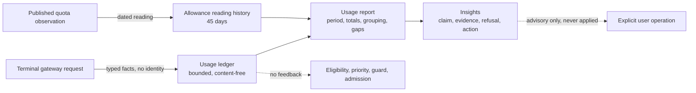

# Usage analytics and insights

**Authority**: This document owns the durable usage ledger, retained allowance
readings, usage reports, and insights. The [product contract](../product/spec.md#billing-quota-and-renewal-information)
owns billing scope, provider-reported versus gateway-observed usage, and the
boundary of a cost estimate. [Diagnostics](../diagnostics/spec.md) owns
diagnostic evidence, bounded in-memory request history, and the separate error
log. [Model selection](../model-routing/spec.md#selection-and-continuity) owns
quota observations and candidate eligibility; [inputs](../model-routing/inputs/spec.md#input-records)
owns routing input heads. [Configuration](../configuration/spec.md) owns saved
settings and the local artifact boundary. The [CLI contract](../cli/spec.md)
owns grammar and exits; [usage commands](../cli/usage/spec.md) own result data.
Shared terms are defined in [CONTEXT.md](../../CONTEXT.md).

This is a target contract, not an implementation claim. The
[product implementation status](../product/spec.md#implementation-status) remains
applicable.

## Scope

The product computes usage analytics only from requests that passed through the
tmax gateway. Traffic sent by a native direct entry, another gateway, or an
Agent's own session files is outside this coverage. The product must not read
Agent session files, reconstruct conversations, or claim per-session, per-project,
or per-turn cost.

A usage report is a dated projection over retained evidence. It is not a
provider's account usage report, an official bill, a remaining quota, or a
statement that no traffic occurred outside its coverage.

## Usage ledger

### Usage records

The gateway records one usage record per terminal request. A request is terminal
when it completed, failed, was rejected, was cancelled, was interrupted, or has a
known unknown outcome. In-progress requests are not recorded. Retries, fallbacks,
and individual upstream attempts do not create separate records; the record
describes the request's final outcome and destination evidence.

A usage record contains only typed, content-free data:

| Data | Required meaning |
| --- | --- |
| Time | Request receipt and admission time in UTC; admission time is absent when admission did not occur. |
| Origin | Ordinary client request or explicit paid probe. A probe remains distinguishable and is not counted as client traffic by default. |
| Requested model and protocol | Validated public model ID, recognized kind (`concrete`, `alias`, or `unknown`), and native protocol when established. |
| Destination | Selected local provider and qualified model only after selection. Pre-selection rejections keep both absent. |
| Native attribution | Safe local Agent target and native provider entry only when independently established by a qualified mechanism; otherwise unknown. |
| Outcome and stage | Final outcome, terminal stage, and a controlled reason code when available. |
| Usage counters | Exclusive input, output, cache-read, and cache-write token counters in tokens, each independently present or absent. |
| Usage state | `reported`, `partial`, `unknown`, or `ambiguous` for that record. |
| Duration | Observed whole-request duration when available. No first-token or generation deadline is derived. |
| Cost estimate | A decimal money estimate with currency, effective-price source, and priced axes when the record can be priced; otherwise absent. |
| Retention markers | No process instance, reset identity, or correlation ID is retained. |

A usage record must not retain a request correlation ID, gateway-process identity,
decision basis, candidate or hold evidence, authorization handles, upstream
account identity, native session identifiers, request or response bodies,
headers, URLs, prompts, completions, tool arguments, or model output.

No operation exposes an individual usage record or reconstructs a request
timeline. Reports expose aggregates only. A usage record is not diagnostic
history, cannot substitute for `history inspect`, and does not prove any request's
content, cause, or execution.

### Retention and availability

Recording is enabled by default. Clearing retained usage is the supported removal
operation; there is no per-request or per-provider exclusion.

Usage records become eligible for eviction after 90 days. The ledger also has a
documented finite row and byte bound. Eviction removes the oldest records first.
The implementation must select, measure, and document the concrete caps; no
numerical row or byte cap is fixed by this specification. Retention enforcement is
a write or explicit clear operation; a read must not prune, rewrite, or mutate the
ledger. A report states the actual retained range and any delayed enforcement.

A report states the ledger's actual retained range and the eviction, dropped, and
clear markers. An empty report means no retained records inside the stated
coverage. It does not mean that no request ran, that a provider reported zero
usage, or that a provider allowance is untouched.

An absent store means no usage was recorded yet. An unreadable, corrupt, or
unsupported-version store means coverage is unavailable. Both must remain
distinct from a report with zero retained records and must never be projected as
zero usage.

Writing a usage record must not delay a request, change forwarding, manufacture a
failure, or require an inference replay. A full write queue or a failed write
drops records, increments a dropped counter, and appears as a coverage gap; it
must not change request admission, forwarding, or outcomes.

Ledger coverage is not process-scoped. Records survive gateway restarts under
their own retention. Diagnostics request history remains memory-only and separate.

### Clear

`usage clear` is an explicit mutation over the ledger and the allowance reading
history. Its optional dry run reports the counts and coverage that would be
removed without deleting data. Execution removes the retained usage records and
allowance readings inside one bounded operation and reports removed and retained
counts, the resulting coverage, and the execution time.

A concurrent write may commit records after the clear begins; those records
remain. A report must never observe a partially deleted ledger.

A successful clear starts a new coverage epoch. `evicted` and `dropped` counters
reset at that epoch, and `cleared_at` names its start. A report states its epoch
and must not imply that pre-clear coverage remains.

Clearing usage must not delete diagnostic request history, the error log,
provider quota observations or their current heads, routing input heads, session
bindings, recovery state, settings, or credentials. It must not reset, prove, or
change any upstream allowance. Clearing usage is not a quota reset and must not
be presented as one.

## Token counters

Token counters are exclusive buckets. Cache reads and cache writes must never be
added to input or output. A provider total counter is not stored as a derived
bucket.

Counter recognition is protocol-scoped. A counter name is recognized only for the
record's native protocol; a name from another protocol's family must not be used.
When a recognized value and an unrecognized competing value would both affect one
priced axis, the record is `ambiguous` for that axis and neither value enters a
total.

A record with no recognized counters is `unknown`. A record whose counters were
partially observed or truncated is `partial`. A record with a conflicting value on
a counted axis is `ambiguous`. A record whose recognized counters are complete and
unambiguous is `reported`.

Reports count records by state and include each axis independently: a known,
nonconflicting counter contributes to its own axis even when another axis of the
same record is unknown, partial, or ambiguous. Counts and sums for an axis with
no known value are null, not zero. A known zero is a value and contributes zero;
it is not the same as an unknown value.

Reports must disclose that a token total counts provider-reported tokens, not a
comparable measure across providers, and that unknown, partial, and ambiguous
values are excluded from the affected axis.

## Cost estimates

A cost estimate is the product of observed counters and an effective price. It is
a locally computed estimate, not a settled charge, invoice, subscription cost, or
proof of what a provider billed.

The effective price resolves in this order for the qualified model: an explicit
local price override, then the accepted catalog reference price. The effective
price uses the catalog's USD-per-million-token convention; an override uses the
same convention. Currencies are not converted, and estimates in different
currencies must never be added.

Only the priced axes that have observed exclusive counters participate: input,
output, cache read, and cache write. A cache axis must not be priced for a
protocol whose cache counters are not recognized. Reasoning and cache-storage
price axes have no observed counters and must be reported as unpriceable rather
than estimated. A price override must identify its source and must not be treated
as a provider tariff.

A cost estimate may overstate when a provider includes cached prompt tokens in its
input counter and no cache counter is recognized. The report must label that
limitation rather than correct an input counter by assumption.

An estimate is frozen when the record is written. A later price change affects new
records only; earlier estimates must never be recomputed or restated. A report
that combines estimates created under different price sources must say so.

A record is `unpriced` when no effective price exists for any of its known priced
counters. An unpriced record must never contribute zero cost and must be counted
beside every affected total. A record is `partially priced` when only some of its
known counters can be priced under the effective price. Reports separate priced,
partially priced, and unpriced counts.

A cost estimate is reported for one provider instance only. The product must not
add estimates from different provider instances, billing scopes, currencies,
windows, or units into one combined total. A per-provider estimate is a usage
estimate, never a billing total. A provider with no priced counters reports an
estimate reason (`unpriced` or `no_priced_axes`) instead of a number. A provider
whose retained records span more than one billing scope reports no combined
estimate (`mixed_billing_scope`) instead of adding those scopes.

A record carries a billing-scope label derived from qualified provider evidence:
`subscription`, `api`, or `unknown` when the evidence does not establish how the
provider bills. Subscription-backed usage is priced at the same effective price
and labeled as an API-equivalent estimate; API-billed and unknown-scope usage are
not. It is not a subscription charge, a renewal amount, or money actually spent.

## Allowance readings

When a provider quota or balance observation is published, the product must retain
a dated allowance reading for display and insight when the reading's identifying
scope or values change. A reading contains the provider instance, an opaque local
binding handle for the observed authorization incarnation and its generation
without a secret or upstream identity, the observed scope or window identity, the
observation source, the observation and receipt times, the display basis
(`consumed_percent`, `remaining_percent`, `counters`, or `credit`), exact decimal
percentage or counter values with their unit, the access state, the reset value
with its qualified encoding, and the freshness at publication.

Change detection uses the provider binding handle, scope or window identity,
source identity, basis, unit, exact values, access state, and reset value. An
observation time alone does not create a reading. Failed attempts, unavailable
facts, and unqualified values do not create readings.

A reading is appended when the observation is published. Appending must not affect
the observation's publication, applicability, or any routing state. A failed
append increments a reading dropped count and appears as a reading coverage gap;
it must not fail, delay, or repeat the observation.

Readings become eligible for eviction after 45 days and a documented finite row
and byte bound. Eviction occurs on a write or explicit clear; the report states
the actual retained range and any delayed enforcement.

Readings are dated evidence, not the current allowance. The current quota
observation remains authoritative for the current value, freshness, applicability,
and any guard or suspension decision under the [model selection](../model-routing/spec.md#selection-and-continuity)
and [billing](../product/spec.md#billing-quota-and-renewal-information) contracts.

An allowance reading must never extend a quota observation's applicability,
replace the current head, prove a reset, prove exhaustion, or become routing,
admission, priority, guard, or failure evidence. No routing or eligibility
operation may read the reading history.

Two readings are comparable only when their provider binding handles and scope
identities match. The product must not compare, subtract, or project across a
changed binding or authorization generation.

## Usage reports

### Period and coverage

A report covers one period: `today`, `7d`, `30d`, `90d`, `all`, or an explicit
`[since, until)` instant range. `today` is the default. Day-based periods start at
the local midnight that begins the trailing calendar-day window and end at the
report instant, using the operating system's time zone. `all` covers the retained
range and ends at the report instant. An explicit range has an inclusive start and
an exclusive end; both bounds are required. The report states its period, time
zone, and resulting instants. Day-based windows and explicit ranges always have
known bounds from the read time; `all` bounds are null only when no record exists.
Unavailable coverage yields null bounds with a typed reason.

A usage record belongs to a period by its admission time, or by its receipt time
when admission did not occur. An allowance reading belongs by its observation
time. The report identifies the timestamp basis it used.

A report is clamped to retained coverage. It must state the ledger's retained
range, every known gap, and whether the requested period extends beyond coverage.
It must not imply completeness for traffic outside the gateway.

The CLI and Web expose the same report and insight facts from the same ledger; the
Web must not compute a second total. CLI reads must work without a running
service. Web reads use the existing local service and must not observe a provider,
refresh credentials, mutate the ledger, or change routing.

Coverage is reported once per result, not per row. A report states that direct and
native upstream traffic is unobserved, that probes are counted separately, and
that diagnostic request history is not part of the report. It reports the
allowance reading range, count, and gaps separately from the ledger.

### Totals and grouping

A report presents:

| Section | Required meaning |
| --- | --- |
| Requests | Terminal gateway requests in coverage, counted once by final outcome: `completed`, `failed`, `rejected`, `cancelled`, `interrupted`, or `unknown`. Probes appear separately. |
| Usage | Exclusive token buckets, the states `reported`, `partial`, `unknown`, and `ambiguous`, and the known zero distinction. |
| Cost | Per-provider estimate with its currency, priced, partially priced, and unpriced counts, and effective-price sources. No combined total appears. |
| Duration | Observed duration percentiles with their sample counts, or an explicit unavailable reason. |
| Allowance readings | Dated provider readings in coverage, with no subtraction from observed usage and no computed remaining allowance. |
| Group rows | Aggregates for one dimension: `provider`, `model`, `requested`, `target`, `protocol`, `outcome`, `origin`, or local `day`. An unknown value appears as an explicit unknown group and must not be filled from current configuration. |
| Gaps | Dropped writes, evictions, clears, unreadable periods, and out-of-coverage ranges. |

Observed usage and allowance readings must remain separate facts. A report must
not subtract observed usage from a reading, present a difference as remaining
allowance, or add local usage to a provider-reported total.

A report must distinguish a known zero from an unknown value and from an absent
record. It must never render unknown as zero, omit it from the adjacent count, or
describe an unobserved scope as zero usage.

A report may contain per-local-day buckets for trend display. Those buckets are
aggregates, not usage records.

### Percentiles

Duration percentiles are computed only from completed requests with a known
observed duration. Probes are excluded from client percentiles. Percentiles use a
documented nearest-rank method.

A percentile is reported only when the sample count reaches a documented minimum
of 20. Below that threshold the report states the sample count and that the
percentile is unavailable; it must not return a percentile from fewer samples.

Percentiles use only observations inside the report's period and coverage. A
report must not borrow samples from outside coverage or from a different period
to meet the minimum.

### What a report must not claim

A report must not claim or derive account-wide usage, remaining quota, a bill, a
provider charge, a subscription renewal, a session or project cost, a per-turn
cost, a five-hour block, an upstream attempt count, a hidden absolute allowance,
or token counts estimated from text.

## Insights

### Insight contract

An insight is a dated, scoped, deterministic statement derived from a report. Each
insight contains: a stable rule ID; its scope and period; a claim with the values
that produced it; the evidence, including coverage and sample counts; any
assumption the claim depends on; and at most one suggested action.

A rule that cannot fire reports a refusal with the rule ID, its evaluated scope,
and one stable reason instead of a claim. A rule with no applicable scope is
omitted from the result. A rule is evaluated for every applicable scope; a scope
with insufficient evidence yields a refusal. When several conditions fail, the
refusal is the first failing condition in the rule's listed condition order. The
result exposes fired insights and refusals separately, and both carry the same
structured scope.

A suggested action names an existing supported operation and its non-secret
arguments, with a preview or dry run where the operation supports one. When no
operation exists, the action is guidance and must not name an invented command.

An insight is advisory. It must never be stored as a fact, applied automatically,
create or modify a routing rule, priority, schedule, quota guard, candidate
eligibility, suspension, or failure counter, appear as a notification or alert, or
promise a spending ceiling. Insights contain no model-generated free text and no
anomaly score.

Insights are recomputed for each report. No insight history is retained.

### Supported insights

| Rule | Fires when | Refusal reasons when evaluated |
| --- | --- | --- |
| `quota_pace` | At least two comparable readings of the same provider binding and window exist, the ledger covers their interval, the basis converts observed tokens to window share, the share moved by at least one percentage point, and a qualified reset exists. | `single_reading`, `binding_changed`, `window_before_coverage`, `coverage_gap`, `unknown_basis`, `low_usage`, `no_reset_clock`, `mixed_credits`, `below_threshold` |
| `unpriced_usage` | At least five unpriced records or at least 10 percent of records are unpriced in the period. | `below_threshold` |
| `failure_cluster` | At least five failed or rejected records share one stage and controlled reason code in the period. | `below_threshold` |
| `cost_concentration` | Within one provider instance, at least 80 percent of records are priced, at least 20 are priced, and one target-and-model pair holds at least 50 percent of that provider's estimated cost. | `low_priced_share`, `low_samples`, `below_threshold` |
| `latency_regression` | The current period's p90 duration is at least 1.5 times the preceding equal period's p90, with at least 20 samples in both. | `low_samples`, `no_baseline`, `below_threshold` |
| `attribution_gap` | At least 20 records exist and at least 50 percent have an unknown Agent target. | `below_threshold` |

A `quota_pace` claim states the observed rate, the reading interval, the reset
assumption, and that the projection is a derived estimate that fails if the rate
or allowance changes. It must not present a projected remaining token count, a
provider limit, or a confirmed exhaustion. The `mixed_credits` refusal applies
when the reading's basis is `credit` or its observation declares credit
consumption.

A `latency_regression` evaluation has no baseline for `all` and reports
`no_baseline`.

Thresholds in this table are product constants, not provider facts. They must be
documented in user-facing help. The product must not add automatic anomaly
detection, learned scoring, text-generated recommendations, or budget and
spending-limit features to this contract.

## Failure and unavailability

Reads must be effect-free. CLI reads must not start or contact the service, observe
a provider, refresh credentials, mutate the ledger, or change routing. Web reads use
the existing local service; they must not start a service, observe a provider,
refresh credentials, mutate the ledger, or change routing.

An absent store, a corrupt or unreadable store, an unsupported store version, and
a failed read are distinct outcomes. Unavailable coverage is reported with a typed
reason and must never be shown as an empty report, a zero total, or a successful
read of no traffic. When coverage is unavailable, totals, cost entries, allowance
readings, insights, and refusals are absent with that reason; the result must not
fabricate zeros or empty success.

## Privacy and data boundaries

The ledger and allowance readings are tmax-owned local artifacts under
`~/.tmax/usage`. They are restricted to the current operating-system user. File
permissions are not encryption.

The product must not upload, sync, or publish usage data, permit remote access to
it, include it in logs, or send it through telemetry. There is no opt-in upload,
anonymous metadata, or vendor analytics.

Only allowlisted typed data may be retained or rendered. Unrecognized, malformed,
or oversized values must be rejected, bounded, or reported as unknown; a truncated
raw value is not sufficient redaction.

## Observable acceptance

1. A terminal gateway request creates at most one usage record with its final
   outcome, destination evidence, and typed counters; retries and fallbacks do not
   create extra records; pre-selection rejections keep destination absent.
2. Retention is bounded and observable. Evictions, dropped writes, clears, and
   unreadable periods appear as coverage gaps. Reads do not prune or mutate.
3. A write failure or full queue does not change request forwarding, admission,
   outcome, or latency semantics.
4. Reports clamp to retained coverage and state period, time zone, direct-traffic
   coverage, probe treatment, and separate diagnostic history. Empty, zero, and
   unknown remain distinct.
5. Unknown, partial, and ambiguous values never enter a total as zero; priced,
   partially priced, and unpriced cost counts are separate; cost is never combined
   across providers or currencies.
6. Duration percentiles require the documented sample minimum and disclose their
   sample count; below it the percentile is unavailable.
7. Cost estimates freeze at write time; a later price change does not restate an
   earlier estimate; subscription usage is never presented as a charge.
8. Allowance readings carry their binding handle and are dated display evidence
   only. No comparison crosses a changed binding, and no eligibility, guard,
   suspension, admission, priority, or failure decision reads them.
9. Clearing usage removes only the ledger and allowance readings; it preserves
   diagnostics, the error log, observations, input heads, bindings, recovery
   state, settings, and credentials, and it never resets an allowance.
10. Insights are deterministic, pull-based, evidence-bound, and never applied; a
    refusal reason appears whenever an evaluated rule cannot fire honestly.
11. CLI reads work without a running service; no read causes an observation,
    refresh, or mutation; unavailable coverage is typed, not empty success.
12. No usage record or report exposes request identity, content, credentials,
    upstream account identity, native session identity, or request bodies.
